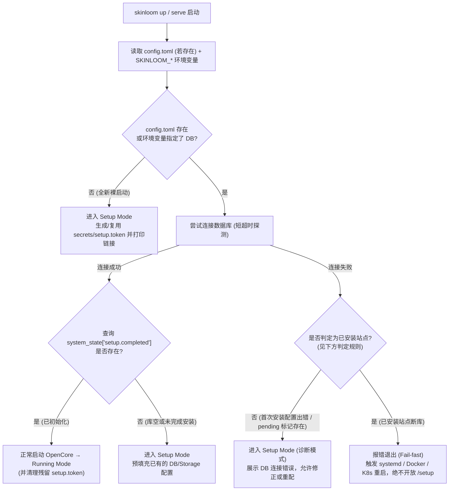

# 08 · 安装与迁移引导流程优化执行方案

> 状态：评审定稿（2026-11-18），待执行。  
> 相关文档：[04 重构方案](04-rewrite-plan.md)、[03 BS 缺陷清单](03-bs-defects.md#1-安全s)（S11）、[ADR 0001](../adr/0001-separate-frontend-with-launcher.md)、[ADR 0006](../adr/0006-hot-reload-model.md)、[ADR 0012](../adr/0012-accounts-sessions-setup.md)、[ADR 0035](../adr/0035-m5-split-and-bs-importer.md)、[ADR 0036](../adr/0036-bs-importer-settings-and-secrets.md)、[`web/design.md`](https://github.com/Entropy-Increase-Team/skinloom/blob/main/web/design.md)。  
> 本文档面向具体实施的研发与 Agent，给出完整的架构设计、安全边界、接口契约、前端交互与逐文件改动清单。

---

## 0. 问题背景与核心评审结论

### 0.1 现状代码暴露的五个结构性卡点

基于当前代码实现，首次安装链路存在以下问题：

1. **启动顺序过早绑定默认数据库与配置**  
   `app.Run`（`internal/app/run.go`）在启动 HTTP 监听与前端之前调用 `app.OpenCore`（`internal/app/core.go`）。`OpenCore` 会立即执行 `config.WriteTemplate`（生成默认 `driver = "sqlite"` 的 `config.toml`）、`db.Open`（直接创建 `data/skinloom.db`）以及 `migrate.Up`；随后 `yggdrasilUpkeep` 在启动瞬间调用 `Warm()` 生成 RSA-4096 密钥并写入 `site_secrets`。用户甚至还没打开安装链接，本地 SQLite 库就已经落盘，无法在 Web 端切换 MySQL / PostgreSQL 或 S3 对象存储。
2. **基础设施（冷键）缺失 Web 引导**  
   `internal/config/config.go` 中 `database.*`、`storage.driver` / `storage.path` 属于需要重启的冷键，而 `web/apps/web/src/components/auth/setup-form.tsx` 与 `internal/httpapi/auth.go` 只支持配置 `siteName`、`siteUrl` 与首个超管账号。对于使用发行包（`start.bat` / `start.sh`）、一体镜像或宝塔/1Panel 部署的站长，若想用外部数据库或对象存储，只能手动关服、手拼 Go 格式 DSN 修改 `config.toml` 再重启。
3. **Setup Token 存储强依赖数据库表**  
   `internal/modules/account/setup.go` 的 `NewSetupToken` 将一次性令牌哈希写入数据库 `auth_tokens` 表，且 `internal/cli/site.go` 的 `setupLinkCmd` 必须调用 `app.OpenCore` 才能生成链接。这使得“数据库还没配置好或连不上时，无法产生安装链接”。
4. **Blessing Skin 迁移与 Web 初始化流程割裂**  
   `internal/importer/bs` 已实现完整的只读事务导入、密码升级、UUID/ID 保留、设置与密钥迁移和 `dry-run` 报告，但仅能通过 `skinloom import bs` CLI 运行。且 `internal/app/import.go` 明确要求站点停机（运行态内存中缓存了 `account.Service.setupDone`、`settings` 快照与 `yggdrasil` 私钥），同时 `ImportBS` 缺少像 `app.Restore` 那样的 `datalock.Exclusive` 互斥保护。在 Docker 未挂载 BS 目录或桌面端自动打开浏览器进入 `/setup` 的场景下，极易误占坑导致不得不删库重来。
5. **首装容错与反代引导不足**  
   首次启动若环境变量或配置文件中的 DB DSN 写错，进程直接失败退出；而在 Nginx/Caddy/Docker 反代后首次访问 `/setup` 时，`server.trusted_proxies` 默认为空，影响真实客户端 IP 识别和协议头判断。

### 0.2 四项关键决策与复审结论

| 决策项 | 最终拍板方案 | 评审依据与边界 |
|---|---|---|
| **1. 大文件上传（默认上限 1 GB）与 >1 GB BS 迁移方案** | **<= 1 GB**：Web 向导采用**分片上传**（8 MB/片）传输 `.tar.gz` / `.zip` 材质包。<br>**> 1 GB**：双轨支持——(A) 立即可用：Web 先导库 + 服务端路径直读 / `rsync`/`rclone` 同步后在后台“校准补扫”；或运行 CLI `skinloom import bs`；(B) 配套扩展：**BS 迁移桥接插件（`blessing-skin-export-bridge`）+ SkinLoom 原生 Live Bridge Pull 拉取协议**（详见第 5 节专项评审）。 | 单请求 POST 上传 1 GB 会被 Nginx 默认 `client_max_body_size 1m`、Cloudflare（100 MB 单请求限制）以及 Huma 默认 5s/1MB 限制直接打回，因此 <= 1 GB **必须分片上传**。>1 GB 若让 PHP 插件在服务器打包下载同样会触发 PHP 超时和双倍磁盘占用，故插件路线必须采用“分页 JSON + 按 hash 并发拉取单个材质”的桥接模式。 |
| **2. 全新建站内嵌可选 SMTP** | 在“全新安装”步骤内嵌默认折叠的**邮件配置（可选）**，支持 `none` / `smtp` / `log`，并直接复用 `mail.Mailer.Send` 提供**“发送测试邮件”**按钮。 | 不阻塞急于建站的默认用户（可一键跳过），又让需要邮箱验证与找回密码的站长一次配置到位；校验逻辑完全复用 `mail.SettingDefs()`。 |
| **3. Kubernetes / 多副本扩容** | 明确约定：**安装期单副本运行（`server.replicas = 1`），安装完成后支持水平扩容（`replicas > 1`）**。 | 安装完成时写入 DB `system_state['setup.completed']`；后续扩容出的新副本（即使 `persistence.enabled=false`、`emptyDir` 下无 `config.toml`）启动时读取 `SKINLOOM_DATABASE__*` 连上数据库并检测到 `setup.completed`，自动跳过 Setup Mode 直接进入运行态加入集群。 |
| **4. “接入已有外部数据库”入口定位（复审修正）** | **不作为首页“4 选 1”卡片**。顶层路径保持清晰的 **3 选 1**：① 全新安装、② 从 Blessing Skin 迁移、③ 从备份恢复。仅当用户在配置外部 MySQL/PG 并点击“测试连接”时，若后端探测到该库**已包含 `setup.completed`**，才上下文智能提示：“检测到已有 SkinLoom 数据（N 用户 / M 材质），是否直接保存配置并接入该站点？” | 复审确认：放到首页作为第 4 项会让新用户迷惑；改为在“测试连接”阶段上下文探测触发，既解决了重装容器/`config.toml` 丢失但外部库仍在的恢复痛点，又保证零额外认知负担。安全上，调用方已同时持有服务器 `setup.token` 与目标库账密，且接入操作不新建管理员、不自动登录，无越权风险。 |

---

## 一、总体架构设计：Pre-Core 引导模式与进程内热切换

### 1.1 方案选型结论：Pre-Core Setup Mode

不采用“先 `OpenCore` 初始化默认 SQLite 再在请求里销毁重建”的方案，而是将启动流程拆分为两个阶段：

1. **Setup Mode（引导安装态）**：不写入默认 `config.toml`，不创建 `skinloom.db`，不运行 `migrate.Up`，不启动 `Jobs` / `yggdrasilUpkeep` / `dailyUpkeep`。只启动：
   - `gateway.Gateway`（分流请求与反代前端）
   - `launcher.Web`（在 `managed`/`dev` 模式下正常拉起并监管 Next.js，或代理到 `external` 前端容器）
   - `httpapi`（Setup Mode 装配：开放 `/api/v1/site/bootstrap`、`/api/v1/setup/*`、`/healthz`、`/readyz`、`/events`、`/themes-assets/*`、`/api/docs`）
2. **Running Mode（正常业务态）**：当安装 / BS 导入 / 备份恢复在事务中落盘后，进程内同步执行 `OpenCore`、启动后台任务协程，并将 `gateway` 的后端处理器**原子切换**为完整 `httpapi`，**全程无需重启进程或容器**。

### 1.2 启动判定状态机与安全边界



**已安装站点防护规则（防止生产断库意外暴露 `/setup`）**：
- 在首次成功完成安装或以已安装态完成 `OpenCore` 时，若使用本地磁盘写入 `config.toml`，可在 `<data>/secrets/` 或安装流程中保证：只要 `config.toml` 已存在且不存在未完成引导状态（`<data>/secrets/setup.pending` 不存在、且环境变量没有处于首次调试期），或已确认曾经进入过 Running Mode，任何后续数据库断连**必须直接报错退出**，严禁降级回 Setup Mode。
- 相反，只有以下三种情况允许进入 Setup Mode：
  1. `config.toml` 不存在且数据库未标记 `setup.completed`（含全新部署以及 k8s 环境变量指向空库的首启）；
  2. 数据库可连通但 `system_state['setup.completed']` 不存在；
  3. 存在 `<data>/secrets/setup.pending` 标记（例如用户在向导中写盘异常或重启前未完成安装）。一旦完成安装，立即删除 `setup.pending` 与 `setup.token`。

### 1.3 Setup Token 文件化设计

将安装令牌从数据库 `auth_tokens` 表解耦至 `<data>/secrets/setup.token`：

- **文件格式**（JSON，权限 `0o600` + `fsperm.Private`）：
  ```json
  {
    "tokenHash": "<hex(sha256(rawToken))>",
    "expiresAt": "2026-11-19T13:30:00Z",
    "createdAt": "2026-11-18T13:30:00Z"
  }
  ```
- **生成与刷新逻辑**：
  - 使用与 `secrets.Ensure` 相同的临时文件 + `os.Link` / `O_EXCL` 原子写机制。
  - 每次在未安装状态下执行 `skinloom up`（若无有效未过期 token 或需要打印链接时）或 `skinloom setup-link` 时，生成新的 32 字节随机令牌（URL-safe/hex 编码，保持 `wellFormedToken` 格式兼容），**24 小时有效**。注意：为避免容器自动重启或重复调用 `setup-link` 时让刚复制的链接失效，若希望和现有一致支持多个未过期令牌或单最新令牌，可在文件中保存最近 N 个（如最多 5 个未过期 hash 数组），安装完成后整体删除 `setup.token` 文件。
- **CLI `skinloom setup-link` 同步解耦**：
  - `internal/cli/site.go` 中的 `setupLinkCmd` 不再无条件调用 `app.OpenCore`。
  - 改为：仅当 `config.toml` 或 `SKINLOOM_DATABASE__*` 已配置时轻量探测数据库是否已 `setup.completed`（已安装则报错 `setup is already complete`）；否则直接生成并写入 `<data>/secrets/setup.token` 并打印 `/setup?token=...`，**即使还没配好数据库也能运行**。

### 1.4 探针、Gateway 原子切换与 SSE 共享

1. **`/healthz` 与 `/readyz`**：
   - Setup Mode 下 `/healthz` 返回 `200 ok`。
   - `/readyz` 检查本地托管前端 `WebReady()`（外部前端或 `off` 时为 `true`），就绪即返回 `200 ready`。**切勿在 Setup Mode 让 `/readyz` 返回 503**，否则 Kubernetes Ingress / Docker Compose 会阻止用户浏览器打开 `/setup` 页。
2. **`gateway.Gateway` 原子切换**：
   - 在 `internal/gateway/gateway.go` 中将 `api http.Handler` 改为 `api atomic.Pointer[http.Handler]`，新增 `SetAPI(h http.Handler)` 方法。
   - 在 `app.Run` 启动阶段创建共享的 `*pubsub.Broker` 与 `*theme.Registry`（预加载 `themes.Builtin`）。
   - Setup Mode 启动时用该 `Broker`、`Themes` 与 `SetupController` 构造 `httpapi.New(...)`；完成安装并执行 `OpenCore` 时把同一个 `Broker` 注入（或复用），调用 `gw.SetAPI(fullAPI)` 并向 `Broker` 发布 `TopicConfigChanged`，所有已打开的浏览器标签页通过 `/events` SSE 收到事件并自动 `router.refresh()`。
3. **防止测试与 OpenAPI 漂移**：
   - `internal/httpapi/api.go` 的 `New(d Deps)` 始终注册全部 Huma 路由（含 `registerSetup(api, d)`），因此 `go generate ./api` 与 `bun run gen:api` 能完整产出所有 Setup 接口类型。
   - `Deps.Setup` 为可选接口：当 `d.Setup == nil`（如现有单元测试 `newTestDeps`）时，`POST /api/v1/setup` 保持直接走 `d.Accounts.CompleteSetup` 的旧路径，保证所有现有 `internal/httpapi/*_test.go` 无需改写即可通过。
   - 当 `d.Setup != nil && d.DB == nil`（Setup Mode）时，除 `/api/v1/site/bootstrap`、`/api/v1/setup/*`、`/events`、`/healthz`、`/readyz`、`/api/docs`、`/themes-assets/*`（需判空 `d.Settings != nil`）外，其余业务 API 请求统一返回 `503 Service Unavailable`（RFC 9457 `problem+json`：`setup not completed`）。

---

## 二、安全边界与防护设计

1. **Token 前置门禁（Token Gate）**：
   - 严禁未验证 Setup Token 时访问数据库测试、S3 测试、环境变量探测、BS `.env` 读取、分片上传或备份恢复接口。
   - 验证入口：`POST /api/v1/setup/session` 验证 token（使用 `crypto/subtle.ConstantTimeCompare` 比对 SHA-256 哈希），通过后下发签名/随机绑定的 `HttpOnly; SameSite=Lax` Cookie（名 `skinloom_setup`，路径 `/api/v1/setup`，HTTPS 时设 `Secure`），内部存储于内存会话表（TTL 2 小时，随安装结束销毁）。
   - 为防御暴力猜测，对 `/api/v1/setup/session` 与 `POST /api/v1/setup` 增加按客户端 IP（基于 `gateway.ClientInfo`）的限流（例如 15 分钟内最多 20 次失败）。
2. **扩展 `csrfGuard` 保护范围**：
   - `internal/httpapi/auth.go` 中的 `csrfGuard` 当前仅在存在 `skinloom_session` 或命中 `sessionEndpoints` 时校验 `X-SkinLoom-Request` 与 `Origin`。
   - **必须将 `/api/v1/setup` 前缀（包含 `/api/v1/setup/*`）纳入 `csrfGuard` 强制校验**，并且检查 `skinloom_setup` Cookie，防止第三方网页利用站长正在开着的浏览器标签发起跨站配置修改或 BS 探测。
3. **环境变量与密钥脱敏（防 BS S11 回显漏洞）**：
   - 任何 `GET` 接口绝不返回已配置或环境变量注入的数据库密码、S3 `secret_key`、SMTP 密码或 BS `SALT` / 密码。
   - 若字段由 `SKINLOOM_*` 环境变量覆盖，仅返回 `lockedByEnv: true` 与脱敏摘要（如驱动类型与 `host:port/db` 掩码）。
4. **`config.toml` 安全写盘**：
   - 由向导生成或更新 `data/config.toml` 时，**禁止使用 `0o644`**；必须采用临时文件 + `0o600` + `fsperm.Private(path)` + 原子重命名（避免向普通本地用户泄露 DB 密码或 S3 `secret_key`）。
   - 被 `SKINLOOM_*` 环境变量覆盖的字段（尤其是敏感密钥），默认不写入 `config.toml`，仅保留模板注释提示由环境变量提供。
5. **归档上传安全（Zip-Slip 与 Zip-Bomb 防护）**：
   - 材质压缩包（`.zip` / `.tar.gz`）和备份包上传均限制总大小默认 **1 GB**（可通过环境变量 `SKINLOOM_SETUP__MAX_UPLOAD_BYTES` 调整），单片限制 8 MB。
   - 解压前校验条目数上限（如 300,000）、单文件上限（`64 MiB`，与 `bs.maxFileSize` 一致）、总解压字节数上限（如 `4 GiB`）。
   - 严格拒绝符号链接（`TypeSymlink` / `TypeLink`）、设备节点与包含 `..` 或绝对路径的条目；对于 BS 材质包，仅解压常规文件，支持平铺或自动剥离单层常见前缀（如 `textures/`、`storage/textures/`）。

---

## 三、REST API 契约设计（`/api/v1/setup/*`）

所有接口除分片上传二进制流与进度 SSE 外，均通过 Huma 注册在 `/api/v1/setup/*`，自动纳入 `api/openapi.json` 并由 Orval 生成 `@skinloom/api-client`。

| 接口 | 方法 | 认证要求 | 说明与关键字段 |
|---|---|---|---|
| `/api/v1/setup` | `GET` | 公开 | 返回 `{ needsSetup, setupLockedByEnv }`（不泄露任何配置细节）。 |
| `/api/v1/setup` | `POST` | 令牌（Body `token`） | **保持向后兼容**（`smoke.sh` 直接调用）：单步完成“默认/环境变量 DB + 存储 + 站点 + 超管创建”并原子切入 Running Mode。 |
| `/api/v1/setup/session` | `POST` | 令牌（Body `token`） | 校验安装令牌并种下 `skinloom_setup` 会话 Cookie；返回当前向导状态摘要。 |
| `/api/v1/setup/state` | `GET` | `setup` 会话 | 返回脱敏后的初始化环境上下文：当前 `database`/`storage` 是否被 env 锁定、探测到的反向代理 IP 与建议 `trusted_proxies`、建议 `siteUrl`、当前默认时区、是否有进行中的导入/恢复任务。 |
| `/api/v1/setup/test-db` | `POST` | `setup` 会话 | 接收结构化 DB 配置（`driver`, `host`, `port`, `database`, `username`, `password`, `sslMode`, `sqlitePath`, `rawDsn`）或使用 env 配置；执行 5s 超时探测，返回 `{ ok, dialect, version, state: "empty" \| "skinloom_installed" \| "suspected_bs" \| "missing_db" \| "error", summary, hintSql, errorDetail }`。 |
| `/api/v1/setup/test-storage` | `POST` | `setup` 会话 | 接收 `local` 或 `s3` 参数，校验必填项与 endpoint 格式，写入/读取/删除临时探针对象以验证权限。 |
| `/api/v1/setup/test-mail` | `POST` | `setup` 会话 | 接收可选 SMTP 参数与收件人 `to`，直接调用 `mail.Mailer.Send` 同步发一封测试邮件并返回真实 SMTP 结果。 |
| `/api/v1/setup/connect-existing` | `POST` | `setup` 会话 | 当 `test-db` 返回 `skinloom_installed` 且用户确认接入时：写入 `config.toml`（含所选存储与反代设置），删除 `setup.token`，执行 `OpenCore` 并切换 Running Mode，返回 `{ redirectTo: "/auth/login" }`。 |
| `/api/v1/setup/complete` | `POST` | `setup` 会话 | **新向导建站终点**：提交 DB 配置、Storage 配置、`trustedProxies`、`siteName`、`siteUrl`、`timezone`、管理员账号以及可选 `mail` 配置；内部一次性执行写配置 → 建库迁移 → `CompleteSetup` → 保存设置 → `OpenCore` → 切换网关并签发 `skinloom_session` Cookie。 |
| `/api/v1/setup/uploads` | `POST` | `setup` 会话 | 创建上传会话（`purpose: "bs_textures" \| "backup"`, `filename`, `totalSize`），校验 `totalSize <= 1 GiB` 及磁盘空间，返回 `{ uploadId, chunkSize: 8388608 }`。 |
| `/api/v1/setup/uploads/{id}/chunks` | `PUT` | `setup` 会话 | **分片上传接口**（原始 `chi` 路由或 Huma RawBody，设置 `MaxBytesReader` 为 `9 MiB` 与 `BodyReadTimeout: 2m`），带 `?offset=<bytes>` 写入暂存文件，返回 `{ received, complete }`。 |
| `/api/v1/setup/bs/parse-env` | `POST` | `setup` 会话 | 接收浏览器上传的 `.env` 文本或服务端 `.env` 路径，调用 `bs.FromEnv` 解析并返回结构化、脱敏后的 BS 源参数（含驱动、主机、库名、前缀、算法列表、是否检测出对象存储 `FS_DRIVER`、是否包含邮箱配置、容器内 `127.0.0.1` 预警）。 |
| `/api/v1/setup/bs/test-source` | `POST` | `setup` 会话 | 只读连接测试 BS 数据库与可选本地材质目录校验，返回 `{ ok, counts: { users, players, textures, closet }, hasYggdrasilKey, textureDirStats }`。 |
| `/api/v1/setup/bs/dry-run` | `POST` | `setup` 会话 | 异步启动 `bs.Run(..., DryRun: true)` 预检任务，返回 `{ jobId }`。 |
| `/api/v1/setup/bs/import` | `POST` | `setup` 会话 | 异步启动正式导入与切服任务（传入确认的目标 DB/Storage/Proxy、BS 源参数、可选覆盖 `siteUrl` 与无超管时的兜底超管账号），返回 `{ jobId }`。 |
| `/api/v1/setup/restore/inspect` | `POST` | `setup` 会话 | 检查上传的备份 `uploadId` 或本地备份路径，只读解析 `manifest.json`，返回版本、时间、数据库方言、`hasDatabase`、材质数与兼容性检查结果。 |
| `/api/v1/setup/restore/execute` | `POST` | `setup` 会话 | 执行 `backup.Restore`（若备份无外部库则先校验用户提供的目标 MySQL/PG 已就绪或由引导先导 SQL），迁移并热切换为 Running Mode。 |
| `/api/v1/setup/jobs/{id}` | `GET` | `setup` 会话 | 轮询或 SSE 获取预检/导入/恢复的实时阶段、百分比、已处理文件数、结构化 `bs.Report` JSON 或最终结果。 |
| `/api/v1/setup/jobs/{id}/report.txt` | `GET` | `setup` 会话 | 下载 `bs.Report.WriteText` 生成的纯文本完整迁移报告（`Content-Disposition: attachment`）。 |

> 注：同时修正 `GET /api/v1/site/bootstrap`（`internal/httpapi/site.go`）：在 Setup Mode 下 `d.Settings == nil` 时返回默认主题与默认站点信息及 `needsSetup: true`，不依赖数据库查询。

---

## 四、Web 安装向导界面与交互设计

遵循 `web/design.md` 设计系统：仅使用 `@skinloom/ui` 组件库与语义 Token（`primary`、`highlight`、`success`、`destructive`、`muted`），禁止渐变与硬编码色值，每屏只保留一个主操作按钮，移动端（375px）无横向溢出。

### 4.1 整体向导路径

```text
[/setup 或 /setup?token=…]
   │
   ├─ (未验证 Token) ──▶ [Step 0: 安全门禁]
   │                        • 自动提取 URL ?token 并脱敏地址栏
   │                        • 支持直接粘贴整条带 ?token= 的链接或手动输入令牌
   │                        • 折叠展示 Docker / 发行包 / Systemd 日志取令牌命令（CopyField）
   │
   ▼ (Token 验证通过)
[Step 1: 选择安装方式]（3 张单选卡片）
   ├─ 1. 全新安装 SkinLoom（新站推荐）
   ├─ 2. 从 Blessing Skin 迁移
   └─ 3. 从 SkinLoom 备份恢复（.tar.gz）
   │
   ▼
[Step 2: 基础设施配置（数据库 · 存储 · 反向代理）]
   ├─ 数据库选择：SQLite | MySQL / MariaDB | PostgreSQL（结构化表单 + 原始 DSN 切换）
   │    • 若由环境变量接管：显示只读托管状态 + "测试连接"
   │    • 若测出已有 SkinLoom 数据：上下文弹窗引导"直接接入此已有站点"
   │    • 若测出疑似 BS 原库：红色 Alert 警告禁止复用，提示建空库
   ├─ 对象存储选择：本地磁盘（默认）| S3 兼容（阿里云 OSS / 腾讯云 COS / R2 / MinIO 快捷预设）+ 测试读写
   └─ 反向代理提示（若检测到 X-Forwarded-* 来自私有/本地代理）：一键勾选加入 trusted_proxies
   │
   ▼ (按 Step 1 所选分支进入对应 Step 3)
   ├─ [分支 A: 全新安装] ──▶ 站点名称 / 站点地址 / 时区 + 超管邮箱 / 昵称 / 密码
   │                         + 可折叠 [邮件 SMTP 配置（可选）+ 发送测试邮件]
   │                         ──▶ 完成并自动登录跳转后台
   │
   ├─ [分支 B: BS 迁移]  ──▶ ① 源端配置：上传 BS .env / 填路径 / 手填参数 + 测试只读连接
   │                         ② 材质来源：服务端路径 | 分片上传压缩包 (<= 1 GB) | 暂不导文件（大站稍后同步）
   │                            （超过 1 GB 时提示可用 CLI / rsync 稍后补扫 / BS 桥接插件说明）
   │                         ③ 点击"开始预检 (Dry-Run)" ──▶ 可视化迁移报告：
   │                            - 🔴 BLOCKING（阻止，修复后重新预检）
   │                            - 🟠 LEFT IN BLESSING SKIN（未导插件与表清单）
   │                            - 🟡 WARNING / 🔵 FIXED / ⚪ DROPPED 分类 Tabs + 下载 .txt 报告
   │                            - 确认迁移后 site.url +（若 Superadmins==0 则补填兜底超管）
   │                         ④ 点击"开始正式导入" ──▶ 实时进度条 ──▶ 完成并提示用原 BS 超管登录
   │
   └─ [分支 C: 备份恢复] ──▶ 上传 .tar.gz（分片 <= 1 GB）或指定本地备份文件
                             ──▶ 展示 Manifest 校验信息（若含外部库提醒先导 SQL）
                             ──▶ 一键恢复并切入站点
```

### 4.2 全局引导入口改进

- `web/apps/web/src/components/shell/site-header.tsx`：当 `boot.needsSetup === true` 且当前不在 `/setup` 时，顶栏提示条增加直达 `/setup` 的按钮链接（而不只是提示命令行）。
- `web/apps/web/src/app/(site)/setup/page.tsx`：支持携带 `?token=` 自动校验进入 Step 1，也支持裸访问 `/setup` 停留在 Step 0 输入/粘贴链接。

---

## 五、专项评审与设计：>1 GB 迁移与 Blessing Skin 桥接插件方案

针对“材质包超过 1 GB 的迁移场景”，结合现有代码架构评审如下：

### 5.1 为什么不建议“BS 插件打包导出再上传”

1. **BS 端极易超时/爆盘**：超过 1 GB 的材质由 PHP 在 HTTP 请求中递归打包成 `.zip`/`.tar.gz`，大概率触发 PHP `max_execution_time`、FastCGI 超时与临时磁盘翻倍占用；
2. **无法解决 BS 使用 OSS/COS/Qiniu 插件时的搬迁难题**：把云端文件先全部下回 PHP 服务器打包、再上传给 SkinLoom 极其低效。

### 5.2 推荐的混合策略（立即可用 + 桥接插件协议预留）

#### 策略一：内置立即可用的 >1 GB 方案（Phase 2 必做）
- **场景 1（同机 / Docker 挂载）**：直接在 Web 向导“材质来源”选择**服务端路径**，由后端 Go 直接并发读取，**零传输开销、无体积上限**。
- **场景 2（跨服务器 / 无挂载 >1 GB）**：
  1. 在 Web 向导填写或上传 `.env` 连上 BS 数据库，材质来源选择 **“先导入数据库，材质文件稍后通过 rsync / rclone / OSS 工具同步”**；
  2. BS 数据库记录秒级导入完成（利用 `internal/importer/bs/plan.go` 已有特性：缺失文件的纹理仍按原 `hash` 导入并保留全部玩家穿戴关系）；
  3. 站长使用 `rsync` / `rclone` / 云厂商迁移工具将材质复制到 SkinLoom `data/textures` 或 S3 桶对应前缀；
  4. **新增后台一键校验能力**：在“后台 → 系统状态”或 `skinloom textures rescan` 中增加“补扫缺失材质元信息”任务，对数据库中 `width = 0` 的 `blobs` 检查存储中文件是否已到位，重新校验 SHA-256 与 PNG 尺寸并回填 `width`、`height`、`size`（注：`SweepOrphans` 只删除无 `blob` 行的文件，因此先导库后放文件是安全无误删风险的）。

#### 策略二：BS 迁移桥接插件 + SkinLoom 原生 Live Pull（Phase 3 / 独立伴侣插件）
如果希望完全不暴露 3306 端口、不开 SSH、且 BS 仍在公网运行（甚至材质在 OSS/COS）也能点几下鼠标迁完：
- **架构方式**：开发一个独立仓库维护的只读 Blessing Skin PHP 插件（`blessing-skin-export-bridge`，遵循 BS v6 插件规范，代码不混入 `skinloom` 主仓），与 SkinLoom 内置的 `bs.BridgeClient` 拉取器对接（`protocolVersion: 1`、`capabilities`、`extensions` 为未来 SkinLoom v2 插件化迁移预留扩展边界），采用 **“流式分页拉取元数据 + 并发按 Hash 流式拉取校验单文件”** 的 Live Pull 模式：
  1. **BS 端操作**：站长在 BS 后台安装启用该插件 → 开启维护模式（保证导出一致性）→ 插件页生成 **Bridge URL + 一次性 256-bit Secret Token**（默认 2 小时过期，迁移完一键吊销/卸载）。
  2. **SkinLoom 端操作**：在 `/setup` 的 BS 迁移页新增第 4 种源接入方式 **“通过 BS 迁移插件公网拉取”**，填入 BS 站点 URL 与 Bridge Token。
  3. **极简协议规范（3 个只读端点，全带 `Authorization: Bearer <token>` + 可选 HMAC 防重放）**：
     - `GET /plugin/skinloom-bridge/manifest`：返回 BS 版本、`DB_PREFIX`、密码算法配置（`PWD_METHOD`/`SALT`/`PASSWORD_METHODS`）、邮件配置（`MAIL_*`）、表总数预估、以及数据库 `options`（含 `ygg_private_key`）、`language_lines`、`oauth_clients`。
     - `GET /plugin/skinloom-bridge/rows?table=users&after_id=0&limit=1000`：按主键游标分页导出 `users`、`players`、`textures`、`user_closet`、`reports`、`notifications`、`uuid`、`other_tables` 统计，直接拼装成 SkinLoom 现有的 `bs.sourceData`（**完全复用 `bs.plan()` 与 `bs.write()`，零重复业务逻辑**）。
     - `GET /plugin/skinloom-bridge/textures/{hash}`：直接通过 BS 当前文件系统/对象存储驱动返回对应材质二进制流（或 302 到短时签名 URL）；SkinLoom 用 `errgroup` 并发拉取并校对 SHA-256 后写入目标 `storage.Store`（Local 或 S3），支持失败重试与断点续传。
  4. **强制安全约束**：
     - 因 `/manifest` 传输密码哈希、邮箱、OAuth 密钥、`MAIL_PASSWORD` 与 `ygg_private_key`，**非内网地址默认强制要求 `https://`**（仅允许用户显式勾选“我确认处于可信内网”才放行 `http://`）；
     - 严禁导出 BS `APP_KEY` 与会话表；
     - 每次启动拉取前检测 BS 是否处于维护模式，未开启时在 UI 显著警告可能漏掉迁移期间的新注册/上传数据。

> **代码解耦要求**：在 Phase 2 改动 `internal/importer/bs` 时，顺手把 `read` 与 `copyFiles` 抽象为 `SourceReader` 与 `FileFetcher` 两个小接口，这样 Phase 3 接入 BS Bridge Plugin 时**无需再改动 `plan.go`、`write.go`、`report.go` 核心逻辑**。

---

## 六、精确改动文件清单（供执行 Agent 参照）

严格遵守项目依赖方向：`cli → app → httpapi → modules → platform`（`platform` 不得依赖业务模块，`modules` 不得依赖 `httpapi`）。

### Phase 1：Pre-Core 引导架构 + DB / 存储 / 反代配置 + 备份恢复

#### 1. 基础设施层 (`internal/platform/*`, `internal/config`, `internal/gateway`)
- **修改 `internal/platform/secrets/secrets.go` & 新增单测**：
  - 新增 `SetupTokenFile(dataDir string) string`（`<data>/secrets/setup.token`）与 `SetupPendingFile(dataDir string) string`。
  - 实现 `CreateSetupToken(dataDir string, ttl time.Duration) (raw string, err error)`、`VerifySetupToken(dataDir, raw string) (bool, error)`、`ClearSetupToken(dataDir string) error`（使用 `0o600` + `fsperm.Private` + 原子写）。
  - 实现 `MarkSetupPending(dataDir string)` / `IsSetupPending(dataDir string)` / `ClearSetupPending(dataDir string)`。
- **修改 `internal/config/config.go` & 新增单测**：
  - 新增 `EnvOverrides() map[string]bool`：检查当前环境变量 `SKINLOOM_*` 覆盖了哪些点分键（如 `database.driver`、`database.dsn`、`storage.driver`、`storage.secret_key`、`server.trusted_proxies` 等）。
  - 新增 `Write(path string, c Config, omitKeys map[string]bool) error`：生成带注释的规范 TOML，跳过 `omitKeys` 中的敏感字段或 env 覆盖键，通过临时文件写入并设置 `0o600` + `fsperm.Private` 后原子 `os.Rename`。
  - 新增 `BuildMySQLDSN(host string, port int, dbName, user, pass string) string` 与 `BuildPostgresDSN(...) string`，统一处理特殊字符转义。
- **修改 `internal/platform/db/db.go`**：
  - 新增 `Probe(ctx context.Context, o Options) (ProbeResult, error)`：供 Setup 阶段探测目标库版本与表状态（`empty` / `skinloom_installed` / `suspected_bs` / `missing_db`），不主动触发迁移。
- **修改 `internal/gateway/gateway.go` & 新增单测**：
  - 将 `api http.Handler` 改为 `api atomic.Pointer[http.Handler]`；新增 `SetAPI(h http.Handler)` 并在 `ServeHTTP` 中原子加载调用。

#### 2. 应用装配与引导协调 (`internal/app`, `internal/cli`)
- **修改 `internal/app/core.go`**：
  - 抽取 `OpenThemesAndRegistry(dataDir string, log *slog.Logger) (*theme.Registry, *settings.Registry, error)`，使 Setup Mode 在无 DB 时也能加载内置主题与设置定义（校验 SMTP / `site.url` / `site.name`）。
  - 调整 `OpenCore`：不再盲目把默认 SQLite `config.toml` 当作已初始化状态，若被 `Run` 的切换逻辑调用，接收已确认的 `Paths` 与共享的 `*pubsub.Broker`（新增 `OpenCoreWithBroker` 或扩展参数）。
- **新增 `internal/app/setup.go` & `internal/app/setup_test.go`**：
  - 实现 `httpapi.SetupController` 接口，持有：
    - `Paths`、`Log`、`Gateway`、共享 `*pubsub.Broker`、内置 `Themes` / `SettingsReg`
    - 内存安装会话表（`skinloom_setup` Cookie → 过期时间，并发互斥锁保证只能完成一次安装）
    - `TestDB`、`TestStorage`、`TestMail`、`ParseEnv`、`TestBSSource`
    - 异步任务管理（`SetupJob`：Dry-Run / BS Import / Restore 进度与结果存储）
    - 分片上传暂存与安全解压（`<data>/import/uploads/` 与 `<data>/import/staging-*`）
    - `completeAndTransition`：写 `config.toml` (`0o600`) → `OpenCore` → 写初始设置 / 完结标记 → 清理 `setup.token` & `setup.pending` → 启动后台协程（`Settings.Watch` / `Jobs.Run` / `upkeep`）→ `gw.SetAPI(fullAPI)` → 广播 `TopicConfigChanged`。
- **修改 `internal/app/run.go` & `internal/app/run_test.go`**：
  - 按第 1.2 节状态机决定启动 Setup Mode 还是直接 `OpenCore`；抽取后台协程启动函数 `startBackgroundWorkers` 供正常启动和热切换复用。
  - **注意 `gw.SetHeaders` 空指针防护**：Setup Mode 阶段尚无 `core.Settings`，在切换至 Running Mode 之前不得调用 `core.Settings.Current()`（或仅在 `OpenCore` 完成后再注册 `gw.SetHeaders`）。
  - 更新 `run_test.go`：`TestRunServesHotReloadAndShutsDownPromptly` 应先通过 `setup.token` 完成 `/api/v1/setup` 热切至 Running Mode，再执行 `PATCH /api/v1/admin/settings` 验证 `config.changed` SSE 与 `config.toml`；另增测试验证“Setup Mode 下未完成初始化直接关闭进程，不会生成 `config.toml` 或 `skinloom.db`”以及“已安装站点断库时 fail-fast 绝不回退 Setup Mode”。
- **修改 `internal/cli/site.go`**：
  - 更新 `setupLinkCmd`：不依赖 `OpenCore` 创建 SQLite，而是优先轻量检查已配置的库是否已完成 `setup.completed`，未安装则直接通过 `secrets.CreateSetupToken` 生成并打印链接。

#### 3. HTTP API 层 (`internal/httpapi`)
- **新增 `internal/httpapi/setup.go` & `internal/httpapi/setup_test.go`**：
  - 定义 `SetupController` 接口及请求/响应模型，注册第 3 节列出的全部 `/api/v1/setup/*` Huma 端点及分片上传与进度 SSE 处理函数。
- **修改 `internal/httpapi/api.go`**：
  - `Deps` 新增 `Setup SetupController`；`New` 调用 `registerSetup(api, d)`。
  - 加固 Setup Mode 请求拦截中间件：当 `d.Setup != nil && d.DB == nil` 时，**仅放行** `/api/v1/site/bootstrap`、`/api/v1/setup`、`/api/v1/setup/*`、`/events`、`/healthz`、`/readyz`、`/api/docs`、`/api/openapi*`、`/api/schemas/*`、`/themes-assets/*`，其余所有业务/游戏/OAuth 路由（避免误触 `d.DB == nil` 闭包引起 panic）一律拦截返回 `503 Service Unavailable`（`application/problem+json`：`setup not completed`）。
  - 修复 `/themes-assets/_custom/*` 在 `d.Settings == nil` 时的空指针防护（`d.Settings == nil` 时返回空串）。
- **修改 `internal/httpapi/auth.go`**：
  - `csrfGuard` 扩展覆盖 `/api/v1/setup` 前缀（含 `/api/v1/setup/*`）与 `skinloom_setup` Cookie。
  - `POST /api/v1/setup` 当 `d.Setup != nil` 时委托给 `d.Setup.CompleteQuickSetup`（保持 `smoke.sh` 单步请求 100% 兼容）：**必须先完成令牌校验、`siteSettings` 校验与 `account.ValidateNewAccount` 校验，全部通过后再写 `config.toml`、建库迁移并切换态**，禁止校验失败前留下半吊子文件；当 `d.Setup == nil` 时保留现有 `d.Accounts.CompleteSetup`（兼容所有 `httpapi` 单元测试）。
- **修改 `internal/httpapi/site.go` & `internal/httpapi/events.go`**：
  - `getBootstrap` 当 `d.Settings == nil` 时组装 Setup Mode 默认引导响应（`needsSetup: true` + 内置默认主题解析）。
  - `serveEvents` 当 `d.Settings == nil` 时发送 `version: 0` 的 `hello` 事件而不 panic。

#### 4. 前端与生成物 (`web/`, `api/`)
- **重新生成 OpenAPI 与客户端**：
  - 运行 `go generate ./api` 更新 `api/openapi.json`。
  - 运行 `cd web && bun run gen:api` 更新 `web/packages/api-client/src/gen/*`。
  - 在 `web/packages/api-client/src/upload.ts` 新增分片上传辅助函数 `uploadSetupArchive(purpose, file, onProgress, signal)`（8 MB/片 + 进度回调 + 失败重试）。
- **修改/新增前端页面与组件**（`web/apps/web/src/`）：
  - 修改 `app/(site)/setup/page.tsx` 与 `components/auth/setup-form.tsx`；在 `components/setup/` 下拆分：
    - `setup-wizard.tsx`（总步骤状态机与进度指示）
    - `token-gate.tsx`（Step 0：令牌校验、URL 脱敏与自动提取、各平台取日志命令）
    - `mode-step.tsx`（Step 1：3 选 1 卡片）
    - `infra-step.tsx`（Step 2：DB 表单化 + 测试连接 + 已有站点上下文提示 + S3 预设测试 + 反代自动勾选）
    - `new-site-step.tsx`（Step 3A：站点 + 超管 + 折叠可选 SMTP 及测试邮件）
    - `restore-step.tsx`（Step 3C：分片上传/本地路径备份恢复与 Manifest 预览）
  - 修改 `components/shell/site-header.tsx`：顶栏未初始化横幅增加直达 `/setup` 链接按钮。
  - 更新 `messages/zh-CN.json` 与 `messages/en.json` 中 `setup` 命名空间文案。

---

### Phase 2：Web 端 Blessing Skin 迁移向导与大站补扫

#### 1. BS 导入引擎增强 (`internal/importer/bs`, `internal/app/import.go`, `internal/modules/texture`)
- **修改 `internal/app/import.go`**：
  - 在 `ImportBS` 中加上 `lockDataDir(p, datalock.Exclusive)`，防止服务运行期间通过 CLI 并发导入。
- **修改 `internal/importer/bs/import.go`, `source.go`, `files.go`, `read.go`, `report.go`**：
  - 为 `report.go` 的 `Report`、`Entry`、`Severity` 增加干净的 JSON tag 供接口序列化。
  - 将 `files.go` 的 `copyFiles` 进度回调从“每 500 个”改为时间/步长节流（每 50 个或 200ms 触发），并为 `scanFiles` 增加扫描进度回调。
  - 抽象 `SourceReader` / `FileFetcher` 扩展口，为 Phase 3 Bridge Plugin 留好接入点。
  - 在 `internal/importer/bs` 增加压缩包内材质根目录自动嗅探（识别平铺 hash、`textures/` 或 `storage/textures/`）。
- **新增后台材质校验补扫能力（`internal/modules/texture` + `internal/httpapi/admin_status.go`）**：
  - 针对 >1 GB 选择“先导库、后 `rsync`/S3 同步文件”的站点，在 `texture.Service` 增加 `RescanMissingBlobs`（仅检查 `width == 0` 的记录，读取存储校验 SHA-256 并回填宽高和真实字节数），在后台系统状态页提供触发按钮（或 CLI `skinloom textures rescan`）。

#### 2. 前端 BS 迁移向导组件 (`web/apps/web/src/components/setup/`)
- **新增 `bs-migrate-step.tsx` & `bs-report-view.tsx`**：
  - 支持上传 `.env` / 填服务端 `.env` 路径 / 手填参数三合一；容器环境下自动预警 `127.0.0.1`。
  - 材质来源支持“服务端目录 / 分片上传 <= 1 GB / 暂不导文件稍后同步”三种切换；超过 1 GB 时在 UI 自动切换引导路径并说明操作步骤。
  - 展示结构化 Dry-Run 报告：`BLOCKING` 置顶拦截、`LEFT IN BLESSING SKIN` 专项面板、`WARNING`/`FIXED`/`DROPPED` 分类 Tab、下载 `.txt` 报告、缺失超管补建表单、实时进度条及完成后对照验证清单（含 `skinloom import compare` 一键复制）。

---

### Phase 3：Blessing Skin 迁移桥接插件（`blessing-skin-export-bridge`）与文档更新

1. **BS 端伴侣插件（独立仓库 `blessing-skin-export-bridge`）**：依据 BS v6 官方插件规范独立建仓实现只读导出端点（`/manifest`、`/rows`、`/textures/{hash}`），支持超管鉴权、SHA-256 哈希短期令牌、可选 IP 白名单与写入冻结，并为未来 SkinLoom v2 插件化迁移预留协议版本与 `extensions` 契约。
2. **SkinLoom 端接入**：在 `internal/importer/bs` 实现 `BridgeSourceReader` 与 `BridgeFileFetcher`，在向导 `bs-migrate-step.tsx` 增加“从 BS 迁移插件公网拉取”选项卡（强制非内网 HTTPS 校验）。
3. **文档与 ADR 同步**：
   - 新增 `docs/adr/0044-interactive-setup-wizard.md` 记录本次方案决策与安全设计；
   - 更新 `website/docs/deployment/quick-start.md`、`website/docs/deployment/from-blessing-skin.md`、`website/docs/deployment/backup-and-cdn.md`、`website/docs/deployment/overview.md`。

---

## 七、交付与验收检查清单（执行 Agent 必须逐项验证）

每阶段完成后，执行 Agent 须对照 `.github/workflows/ci.yml` 与 `CONTRIBUTING.md` 跑通以下全部检查：

```bash
# 1. 代码格式、静态检查与漏洞扫描
gofmt -l $(git ls-files '*.go')
go vet ./...
go run honnef.co/go/tools/cmd/staticcheck@latest ./...
go run golang.org/x/vuln/cmd/govulncheck@latest ./...

# 2. 后端单测、竞态检查及三方言迁移/事务测试
go test ./...
go test -race ./...
# 若配置了测试库环境变量：
# SKINLOOM_TEST_MYSQL=... SKINLOOM_TEST_POSTGRES=... go test -p 1 ./...

# 3. 契约生成物一致性检查（CI 严格校验无漂移）
go generate ./api && git diff --exit-code -- api/
cd web && bun run gen:api && git diff --exit-code -- packages/api-client/src/gen

# 4. 前端类型检查、单测、生产构建与无软链接校验
cd web && bun run typecheck && bun run test && bun run build
test -z "$(find web/apps/web/.next/standalone -type l)"

# 5. 文档站构建（校验新增设计文档/ADR 与 Docusaurus 兼容）
cd website && bun run build

# 6. 端到端冒烟验证（验证单步兼容与向导全流程）
bash deploy/smoke/smoke.sh http://127.0.0.1:17546 "<server logs command>"
```

### 额外功能验收用例

1. **冷启动无残留验证**：空数据目录运行 `skinloom up`，在未完成 `/setup` 前退出，检查 `data/` 下**不存在** `config.toml` 与 `skinloom.db`，只有 `secrets/setup.token` 和锁/日志。
2. **MySQL / PostgreSQL + S3 一次成型**：通过 `/setup` 选择 MySQL/PG 与 S3，测试连通性并完成建站，验证进程**无需重启**自动切换进入正常页面，且 `data/config.toml` 权限为 `0600`。
3. **Compose / K8s 环境变量托管与扩容**：使用 `deploy/compose/standard/compose.yaml`（env 注入 MariaDB）启动进入 `/setup`，确认 DB 字段呈只读托管态；完成初始化后，模拟新节点带空 `/data` 目录连接同一个数据库启动，验证直接跳过 Setup Mode 正常服务。
4. **BS 迁移端到端**：分别验证“上传 `.env` + <= 1 GB 分片压缩包导入”、“存在 `BLOCKING` 冲突拦截与重新预检”以及“无本地目录先导库后补扫”三种路径，确认原 BS 账号密码、UUID、设置、OAuth 与 Yggdrasil 公钥一致。
5. **生产断库安全测试**：已完成安装的站点在 `config.toml` 指向一个停机的 MySQL 后重启，验证进程直接报错退出且**绝不回退开放 `/setup`**。
