# 09 · 插件平台与主题系统（v2.0）完整开发顺序与详细执行方案

> 状态：评审定稿（2026-11-18），待执行。  
> 相关文档：[04 重构方案](04-rewrite-plan.md)、[05 插件与主题开发体系](05-plugin-theme-standard.md)、[06 文档与日志体系](06-docs-and-logs.md)、[07 前端重构方案](07-frontend-redesign.md)、[08 安装与迁移引导方案](08-setup-wizard-plan.md)、[ADR 0005](../adr/0005-typescript-plugin-standard.md)、[ADR 0006](../adr/0006-hot-reload-model.md)、[ADR 0007](../adr/0007-no-sql-for-plugins.md)、[ADR 0043](../adr/0043-local-themes-and-manifest-extensions.md)。  
> 本文档面向后续接手执行的开发 Agent，给出已拍板的架构决策、6 个阶段的严格开发顺序、以及每个阶段精确到文件/接口/数据表/测试用例的落地方案。

---

## 0. 已拍板核心决策（执行 Agent 必须严格遵守）

| 决策项 | 最终方案 | 约束与技术要点 |
| :--- | :--- | :--- |
| **1. 插件市场维护模式** | **模式 A：GitOps 静态签名索引 + CI 分级审核 + 双源归档镜像** | 独立仓库 `skinloom-registry` 维护插件元数据与公钥；作者提 PR 触发 CI 自动跑 `skinloom-plugin lint`、Schema 与签名校验；首次上架或新增敏感/高危权限需人工 Review，常规小版本更新（同公钥 + 权限未扩大 + CI 全绿）自动合并；CI 用官方 Ed25519 私钥签名 `index.v1.json` 并将 `.slp` 归档同步至官方主源与国内 CDN 镜像。 |
| **2. 第一批官方插件** | **① `invitation-codes`（邀请码）**<br>**② `mojang-verification`（正版验证）**<br>**③ `bs-importer`（BS 迁移与插件表导入器）** | 全部使用 `@skinloom/plugin-sdk`（TypeScript）按标准插件开发，放置在仓库 `plugins/` 目录下作为吃自己狗粮的官方标杆插件并纳入 CI 构建测试。同时支持将旧版 BS 的 `invitation_codes`、`mojang_verifications`、`textures_description` 等扩展表数据通过 `bs-importer` 插件迁移入库。 |
| **3. JS 沙箱引擎选型** | **`internal/jsrt` 抽象层 + `fastschema/qjs`（QuickJS-NG on Wazero）** | 纯 Go（`CGO_ENABLED=0`），跨平台一致；Wazero 线性内存硬上限（默认 64 MiB/实例）+ `WithCloseOnContextDone(true)` 抢占式超时中断（防 `while(true){}` 死循环）；WASM 模块预编译 + 每个启用插件维护预热实例池（默认 `size=2`）；完整支持 ES2023 与 `async/await`。 |
| **4. 插件存储实现** | **`plugin_kv` + `plugin_docs`（含静态唯一槽位 `u1, u2`）+ 私有文件空间** | 严禁在运行时动态拼接跨三方言的 `CREATE INDEX` DDL（遵守 ADR 0007）。`plugin_docs` 表预先建好 `s1..s3`（字符串）、`u1..u2`（带 `UNIQUE(plugin, collection, u1)` 的唯一字符串槽位）、`n1..n3`（数值）、`t1`（时间）及复合索引，零运行时 DDL 实现 `:unique` 与高性能索引查询。 |
| **5. 主题系统扩展范围** | **同时实现：`.slp` 包安装/市场分发 + 层级 ⑤ React 组件覆盖（`overrides`）+ 管理员预览模式** | 在 ADR 0043（已完成层级 ①–④）基础上，打通主题 `.slp` 签名打包与市场安装；实现 `site.header`、`site.footer`、`site.logo`、`auth.background`、`home.hero`、`texture.card`、`player.card` 7 个组件的客户端覆盖（SSR 输出默认组件防闪烁，客户端挂载后经 `ErrorBoundary` 替换）；实现管理员会话级主题预览。 |

---

## 一、 完整开发阶段顺序总览（Master Roadmap）

整个插件平台阶段（v2.0）拆分为 **P2-1 至 P2-6 共 6 个阶段**。后续 Agent **必须按顺序逐阶段推进**，每个阶段结束时必须跑通文末的「CI 与回归门禁清单」并提交对应的 ADR 与 devlog。

```mermaid
flowchart TD
    P2_1["<b>阶段 P2-1：后端底座与 JS 沙箱</b><br/>1. ent 新增 plugins / plugin_kv / plugin_docs 表与三方言迁移<br/>2. hook/catalog.go 补齐 21 Guard + 7 Filter + 4 Event 并埋入各业务模块<br/>3. httpapi 注册/登录/上传/建角色接口支持附加 form 字段透传<br/>4. internal/jsrt 实现 Wazero + QuickJS-NG 实例池、内存限制、抢占超时<br/>5. internal/plugin 实现清单解析、权限守卫、核心 ctx.* 与熔断器"]
    --> P2_2["<b>阶段 P2-2：全量宿主能力、类型生成链、SDK 与 CLI</b><br/>1. internal/plugin 补齐全部 25 个 ctx.* 命名空间（含防 SSRF fetch、cron、auth/captcha/cdn 扩展点、services）<br/>2. internal/tools/plugingen 从 Go 目录自动生成 Schema 与 TS 类型<br/>3. web/packages/plugin-sdk 实现 server / web / testing 三个入口<br/>4. web/packages/cli (skinloom-plugin) 实现 build / dev / lint / pack / sign<br/>5. web/packages/create-plugin 实现脚手架模板"]
    --> P2_3["<b>阶段 P2-3：前端插件运行时、插槽/区块与主题 L5 覆盖</b><br/>1. 宿主注入 globalThis.__SKINLOOM_SHARED__ 共享模块表与动态 ESM 加载器<br/>2. 补齐 user / admin / explore 插件页面路由容器与声明式菜单/设置页<br/>3. 在全站页面埋入全部 20 个 <Slot>、扩展注册/登录/上传声明式 forms、支持插件首页 Block<br/>4. 实现主题 Level ⑤ React 组件覆盖 (theme.overrides) 与管理员主题预览模式"]
    --> P2_4["<b>阶段 P2-4：.slp 包管理、Ed25519 签名、权限确认与多副本热加载</b><br/>1. 实现 .slp (zip + checksums.txt + signature) 打包与安全解压校验<br/>2. 实现安装/升级/启停/卸载热加载状态机、在途请求排空 (≤30s) 与 S3 多副本同步<br/>3. 实现 /api/v1/admin/plugins/* 管理接口、CLI skinloom plugin 子命令<br/>4. 实现后台「插件管理」页面（列表、上传安装、三级权限增量确认弹窗、详情/日志/用量）"]
    --> P2_5["<b>阶段 P2-5：插件市场（模式 A）与后台市场 UI</b><br/>1. 建立静态签名索引规范 (index.v1.json + 官方 Ed25519 签名 + yank/blocked 名单)<br/>2. 后端实现多源 Registry 客户端（官方主源 + 国内镜像 + 自定义源）、自动阻断巡检<br/>3. 后台实现「插件与主题市场」页面（分类搜索、兼容标识、权限预览、一键安装/升级）<br/>4. 提供 skinloom-registry 仓库模板与分级审核 GitHub Actions 工作流"]
    --> P2_6["<b>阶段 P2-6：第一批官方插件落地、文档定稿与 API 1.0 冻结</b><br/>1. 落地官方插件 ① invitation-codes（邀请码注册 + 后台管理 + BS 导入扩展）<br/>2. 落地官方插件 ② mojang-verification（Microsoft 正版验证 + 角色绑定/回收 + 徽章）<br/>3. 落地官方插件 ③ bs-importer（BS 迁移桥接扩展表导入与增量同步工具）<br/>4. 落地 1 个含组件覆盖的示例主题 + 补齐文档站「插件开发」全套指南"]
```



### 各阶段依赖与交接边界表

| 阶段 | 前置依赖 | 主要改动目录 | 核心验收标志（Definition of Done） |
| :--- | :--- | :--- | :--- |
| **P2-1** | v1 现有代码 | `ent/schema/`, `migrations/`, `internal/hook/`, `internal/modules/*`, `internal/jsrt/`, `internal/plugin/` | Go 单元测试中可用 `jsrt` 加载一段打包好的 TS/JS 插件代码，拦截 `auth.register` Guard、读写 `ctx.kv` / `ctx.db`、挂载 `/api/plugins/<id>/*` 路由，超时死循环 2s 内被强制中断且不影响后续请求。 |
| **P2-2** | P2-1 | `internal/plugin/`, `internal/tools/plugingen/`, `web/packages/plugin-sdk/`, `web/packages/cli/`, `web/packages/create-plugin/` | `go generate ./...` 自动生成 `plugin.v1.json` 与 SDK 类型；`skinloom-plugin build/lint/pack/sign` 可将 TS/TSX 源码编译为 `.slp` 包；`createTestHost` 可在 Vitest 中单测插件。 |
| **P2-3** | P2-2 | `web/apps/web/src/`, `internal/modules/theme/`, `internal/httpapi/` | 浏览器动态加载 `/plugins-assets/<id>/<rev>/web/index.js`，与宿主共享同一个 React 19 实例；20 个 `<Slot>`、插件页面、声明式表单字段、插件首页区块、主题 `overrides` 组件覆盖与主题预览模式全部跑通。 |
| **P2-4** | P2-3 | `internal/plugin/`, `internal/httpapi/admin_plugins.go`, `internal/cli/plugin.go`, `web/apps/web/src/app/(app)/admin/plugins/` | 后台上传 `.slp` 弹出普通/敏感/高危权限确认框，确认后不重启进程即时生效；升级时旧版排空在途请求后释放；`skinloom-plugin dev` 保存源码秒级热替换前后端。 |
| **P2-5** | P2-4 | `internal/plugin/registry_client.go`, `web/apps/web/src/components/admin/plugin-market.tsx`, `deploy/registry/` | 后台市场可从签名静态源拉取插件/主题列表、一键安装与升级；模拟 `blocked` 恶意插件名单更新后宿主自动禁用并通知超管。 |
| **P2-6** | P2-5 | `plugins/invitation-codes/`, `plugins/mojang-verification/`, `plugins/bs-importer/`, `website/docs/plugins/` | `invitation-codes`、`mojang-verification`、`bs-importer` 三个官方插件端到端测试全绿（含从 BS 导入对应插件表数据）；文档站构建通过；插件 API v1 冻结。 |

---

## 二、 下一阶段（P2-1）超详细开发方案（可直接交由 Agent 执行）

> **P2-1 目标**：在不破坏任何现有 v1 功能与契约测试的前提下，完成**插件数据库表与三方言迁移**、**全量 Hook 目录声明与业务模块埋点**、**扩展表单字段透传**、**`internal/jsrt`（Wazero + QuickJS-NG）沙箱池**，以及 **`internal/plugin` 核心生命周期与基础 `ctx` 能力**。

### 2.1 数据库 Schema 与三方言迁移（`ent/schema/` & `migrations/`）

#### 1. 新增 `ent/schema/plugin.go`（`plugins` 表）
```go
// 主键 id 为 string (kebab-case, maxLen 40)，不使用自增 ID
field.String("id").MaxLen(40).NotEmpty().Unique().Immutable(),
field.Enum("kind").Values("plugin", "theme").Default("plugin"),
field.String("version").MaxLen(64).NotEmpty(),
field.Enum("status").Values("enabled", "disabled", "failed").Default("disabled"),
field.JSON("granted_permissions", []string{}).Optional(),
field.JSON("settings", map[string]any{}).Optional(),
field.String("error").Optional().Default(""),
field.String("source").MaxLen(32).Default("package"), // "local" | "package" | "market"
field.String("package_sha256").MaxLen(64).Optional(),
field.Time("installed_at").Default(time.Now).Immutable(),
field.Time("updated_at").Default(time.Now).UpdateDefault(time.Now),
```

#### 2. 新增 `ent/schema/pluginkv.go`（`plugin_kv` 表）
```go
field.Int64("id"),
field.String("plugin").MaxLen(40).NotEmpty(),
field.String("key").MaxLen(255).NotEmpty(),
field.JSON("value", any(nil)),
field.Time("expires_at").Optional().Nillable(),
field.Time("updated_at").Default(time.Now).UpdateDefault(time.Now),
// Indexes:
// index.Fields("plugin", "key").Unique()
// index.Fields("expires_at")
```

#### 3. 新增 `ent/schema/plugindoc.go`（`plugin_docs` 表）
为彻底避免插件安装时在 SQLite / MySQL / PostgreSQL 上动态拼写 `CREATE INDEX` DDL（遵守 ADR 0007），采用**预置类型化索引槽位列 + 预置唯一槽位列**设计：
```go
field.Int64("id"),
field.String("plugin").MaxLen(40).NotEmpty(),
field.String("collection").MaxLen(64).NotEmpty(),
field.String("doc_id").MaxLen(64).NotEmpty(), // 插件可见的文档 ID (默认生成 UUID/xid)
field.JSON("data", map[string]any{}),
// 唯一字符串索引槽位（供声明了 "string:unique" 的字段映射，最多 2 个；NULL 在三方言 UNIQUE 索引中均允许多个 NULL）
field.String("u1").MaxLen(255).Optional().Nillable(),
field.String("u2").MaxLen(255).Optional().Nillable(),
// 普通字符串索引槽位（供声明了 "string" 的字段映射，最多 3 个）
field.String("s1").MaxLen(255).Optional().Nillable(),
field.String("s2").MaxLen(255).Optional().Nillable(),
field.String("s3").MaxLen(255).Optional().Nillable(),
// 数值索引槽位（供声明了 "number" 的字段映射，最多 3 个）
field.Float("n1").Optional().Nillable(),
field.Float("n2").Optional().Nillable(),
field.Float("n3").Optional().Nillable(),
// 时间索引槽位（供声明了 "time" 的字段映射，最多 2 个）
field.Time("t1").Optional().Nillable(),
field.Time("t2").Optional().Nillable(),
field.Time("created_at").Default(time.Now).Immutable(),
field.Time("updated_at").Default(time.Now).UpdateDefault(time.Now),
// Indexes:
// index.Fields("plugin", "collection", "doc_id").Unique()
// index.Fields("plugin", "collection", "u1").Unique()
// index.Fields("plugin", "collection", "u2").Unique()
// index.Fields("plugin", "collection", "s1")
// index.Fields("plugin", "collection", "s2")
// index.Fields("plugin", "collection", "s3")
// index.Fields("plugin", "collection", "n1")
// index.Fields("plugin", "collection", "n2")
// index.Fields("plugin", "collection", "n3")
// index.Fields("plugin", "collection", "t1")
// index.Fields("plugin", "collection", "t2")
```
- **迁移生成与校验**：运行 `go generate ./ent`，并在 `migrations/{sqlite,mysql,postgres}/` 下新增对应迁移文件（如 `00003_plugin_platform.sql`），确保 `go test ./internal/platform/migrate/...` 与 `go run ./internal/tools/migdiff` 100% 通过。

---

### 2.2 Hook 目录补齐与各业务模块埋点（`internal/hook/` & `internal/modules/*`）

#### 1. 扩充 `internal/hook/catalog.go`
严格对照 [05 §4.4](file:///e:/Dnyo/Documents/work/bs-community/skinloom/docs/design/05-plugin-theme-standard.md) 补齐全部 **21 个 Guard**、**7 个 Filter** 以及尚未发布的 **4 个 Event**：

- **新增 Event（4 个）**：
  - `user.loggedIn` (`UserLoginEvent{ UserID int64, IP string, Method string }`)
  - `user.updated` (`UserUpdatedEvent{ UserID int64, Fields []string }`)
  - `score.changed` (`ScoreChangedEvent{ UserID int64, Delta int64, BalanceAfter int64, Reason string }`)
  - `yggdrasil.joined` (`YggdrasilJoinedEvent{ UserID int64, PlayerID int64, UUID string, ServerID string, IP string }`)
  - *性能保障*：得益于 `hook.Event.Publish` 内置的 `if !e.Listening(b) { return nil }` 短路检查，在没有插件订阅这些高频事件时，**零序列化、零数据库写入开销**。

- **新增 Guard（21 个，全部在参数基础校验之后、开启写库事务之前调用 `Guard.Check`）**：
  | Guard 名称 | 默认 FailPolicy | 载荷结构体要点 (`json` tag 小驼峰) | 埋点文件与函数 |
  | :--- | :--- | :--- | :--- |
  | `auth.login` | `FailClosed` | `Identifier string, UserID int64, IP string, Form map[string]any` | `internal/modules/account/login.go` (`Login`) |
  | `auth.register` | `FailClosed` | `Email string, Nickname string, PlayerName string, IP string, Form map[string]any` | `internal/modules/account/register.go` (`Register`) & `social.go` |
  | `player.create` | `FailClosed` | `UserID int64, Name string, Form map[string]any` | `internal/modules/player/player.go` (`Create`) |
  | `player.rename` | `FailClosed` | `UserID int64, PlayerID int64, OldName string, NewName string` | `internal/modules/player/player.go` (`Rename`) |
  | `player.delete` | `FailClosed` | `UserID int64, PlayerID int64, Name string` | `internal/modules/player/player.go` (`Delete`) |
  | `player.textures.set` | `FailClosed` | `UserID int64, PlayerID int64, SkinID *int64, CapeID *int64` | `internal/modules/player/player.go` (`SetTextures`) |
  | `player.textures.clear` | `FailClosed` | `UserID int64, PlayerID int64, Types []string` | `internal/modules/player/player.go` (`SetTextures` 当清除时) |
  | `texture.upload` | `FailClosed` | `UserID int64, Name string, Type string, Public bool, Width int, Height int, SizeBytes int64, Hash string, Form map[string]any` | `internal/modules/texture/texture.go` (`Upload`) |
  | `texture.rename` | `FailClosed` | `ActorID int64, TextureID int64, OldName string, NewName string` | `internal/modules/texture/edit.go` |
  | `texture.visibility` | `FailClosed` | `ActorID int64, TextureID int64, Public bool` | `internal/modules/texture/edit.go` |
  | `texture.type` | `FailClosed` | `ActorID int64, TextureID int64, OldType string, NewType string` | `internal/modules/texture/edit.go` |
  | `texture.delete` | `FailClosed` | `ActorID int64, TextureID int64, Hash string` | `internal/modules/texture/edit.go` |
  | `closet.add` | `FailClosed` | `UserID int64, TextureID int64, Name string` | `internal/modules/texture/closet.go` (`AddClosetItem`) |
  | `closet.rename` | `FailClosed` | `UserID int64, TextureID int64, OldName string, NewName string` | `internal/modules/texture/closet.go` (`RenameClosetItem`) |
  | `closet.remove` | `FailClosed` | `UserID int64, TextureID int64` | `internal/modules/texture/closet.go` (`RemoveClosetItem`) |
  | `score.checkin` | `FailClosed` | `UserID int64` | `internal/modules/account/service.go` (`SignIn`) |
  | `user.profile.update` | `FailClosed` | `UserID int64, Field string, Value string, Form map[string]any` | `internal/modules/account/profile.go` |
  | `user.avatar.update` | `FailClosed` | `UserID int64, TextureID *int64` | `internal/modules/texture/avatar.go` |
  | `report.submit` | `FailClosed` | `ReporterID int64, TextureID int64, Reason string` | `internal/modules/report/report.go` (`Submit`) |
  | `yggdrasil.authenticate` | `FailOpen` | `UserID int64, Identifier string, IP string` | `internal/modules/yggdrasil/auth.go` (`Authenticate`) |
  | `yggdrasil.join` | `FailOpen` | `UserID int64, PlayerID int64, UUID string, ServerID string, IP string` | `internal/modules/yggdrasil/session.go` (`Join`) |

- **新增 Filter（7 个，出错时自动回退原值）**：
  | Filter 名称 | 值类型 `V` | 上下文载荷 `P` | 埋点位置 |
  | :--- | :--- | :--- | :--- |
  | `player.name` | `string` | `PlayerNameFilterContext{ UserID int64, PlayerID *int64 }` | `player.Create` / `player.Rename` |
  | `texture.name` | `string` | `TextureNameFilterContext{ UserID int64, TextureID *int64, Type string }` | `texture.Upload` / `texture.Update` |
  | `closet.itemName` | `string` | `ClosetNameFilterContext{ UserID int64, TextureID int64 }` | `texture.AddClosetItem` / `RenameClosetItem` |
  | `score.checkinAmount` | `int64` | `CheckinFilterContext{ UserID int64, ConsecutiveDays int }` | `account.SignIn` |
  | `user.badges` | `[]UserBadge` (`{Text, Color, Icon}`) | `UserBadgeFilterContext{ UserID int64, Role string }` | `httpapi/me.go`, `httpapi/textures.go` (上传者信息), `httpapi/admin_users.go` |
  | `profile.textures` | `ProfileTextures` | `ProfileTexturesFilterContext{ PlayerID int64, Name string, UUID string, Protocol string }` | `httpapi/game.go` (CSL/USM) & `yggdrasil` |
  | `yggdrasil.profileProperties` | `[]YggProperty` | `YggPropertiesFilterContext{ PlayerID int64, UUID string, Name string, Signed bool }` | `internal/modules/yggdrasil/yggdrasil.go` |

- **更新 `UserEvent`**：在 `UserEvent` 中增加 `Form map[string]any `json:"form,omitempty"``（仅 `user.registered` 携带，脫敏密码字段后传入，以便像 `invitation-codes` 这样的插件在 `user.registered` 事件中读取 `form.invite_code` 并核销）。
- **HTTP 错误映射**：在 `internal/httpapi/` 中统一处理 `hook.AsRejection(err)`——当任何业务方法返回 `*hook.Rejection` 时，映射为 HTTP `422 Unprocessable Entity`（或 `403 Forbidden`）及 RFC 9457 `problem+json`，`detail` 为 `rejection.Reason`，前端表单直接展示该拒绝原因。

---

### 2.3 JS 沙箱抽象与实现（`internal/jsrt/`）

创建 `internal/jsrt` 包，将第三方引擎完全隔离在内部：

```text
internal/jsrt/
├── jsrt.go           接口定义：Engine, Pool, Instance, HostFunc, Limits, CallStats
├── qjs.go            基于 github.com/fastschema/qjs + tetratelabs/wazero 的实现
├── pool.go           预热实例池（Borrow / Return / ReplaceOnBroken / DrainAndClose）
├── timers.go         受单次调用 Context 约束的 setTimeout / clearTimeout 与 console 桥接
└── jsrt_test.go      单测：ES2023 async/await、Promise 拒绝、死循环 2s 抢占中断、64MB 内存溢出拦截、并发池借还
```

**关键实现要求**：
1. **预编译与池化 (`pool.go`)**：
   - 插件加载时先检验 `server.js` 大小（`<= 5 MiB`），并在第一个实例中试跑模块初始化与 `setup(collectorCtx)`。
   - 池默认维护 `PoolSize = 2` 个已执行完 `setup` 的熱实例。每次触发 Hook、HTTP 路由或 Cron 时，从池中 `Borrow(ctx)` 一个实例，调用对应导出或注册的 JS 函数句柄，完成后 `Return(inst)`。
2. **硬超时与死循环恢复 (`qjs.go`)**：
   - 调用前派生 `ctx, cancel := context.WithTimeout(parentCtx, limit.Timeout)`。
   - 若调用因 `context.DeadlineExceeded` 或 WASM OOM / Trap 失败，标记该 `Instance` 为 `tainted`，丢弃并关闭底层 WASM Module，同时在后台异步补充一个新的预热实例进池，保证后续请求不受污染。
3. **内置全局对象注入**：
   - 提供标准 `TextEncoder`、`TextDecoder`、`URL`、`URLSearchParams`、`crypto.getRandomValues`、`crypto.randomUUID`、`console.{debug,info,warn,error}`（转发到带 `plugin=<id>` 属性的 `slog.Logger`），禁用任何文件系统或宿主环境变量访问。

---

### 2.4 插件管理器与基础 `ctx` 能力（`internal/plugin/`）

创建 `internal/plugin` 包：

```text
internal/plugin/
├── manifest.go       plugin.json 完整解析与校验（兼容 kind: "plugin" | "theme"）
├── permissions.go    三级权限常量表（Normal / Sensitive / HighRisk）与运行时 Check(perm)
├── circuit.go        熔断器：连续失败 >= 5 次自动置为 failed、从注册表摘除并发通知给超管
├── storage_kv.go     ctx.kv 实现（get/set/delete/list/incr + TTL + 配额检查）
├── storage_docs.go   ctx.db.collection 实现（将查询/排序/写入字段映射到 u1..u2, s1..s3, n1..n3, t1..t2）
├── storage_files.go  ctx.files 实现（基于 storage.Store 的 plugins-data/<id>/ 前缀隔离与配额）
├── fetch.go          ctx.fetch 实现（http.allow 域名白名单 + DialContext 私网/Loopback/元数据 IP 拦截）
├── runtime.go        单个插件生命周期封装（setup 收集器、onInstall/onEnable/onDisable/onUpgrade/onUninstall）
├── manager.go        插件总管：扫描加载、热启用/禁用、路由分发 (/api/plugins/<id>/*)、静态资源 (/plugins-assets/*)
└── manager_test.go   完整集成测试
```

**`storage_docs.go` 槽位映射细节（重点）**：
- 在解析 `plugin.json -> storage.collections.<name>.indexes` 时，按字段名排序（稳定顺序）将：
  - `"string:unique"` 固定映射到 `u1`, `u2`（最多 2 个）；
  - `"string"` 固定映射到 `s1`, `s2`, `s3`（最多 3 个）；
  - `"number"` 固定映射到 `n1`, `n2`, `n3`（最多 3 个）；
  - `"time"` 固定映射到 `t1`, `t2`（最多 2 个）。
- `insertOne` / `updateOne` 时自动从 JSON 文档提取这些字段值填入对应槽位列；若唯一槽位冲突，利用 `db.IsUniqueViolation(err)` 转换为统一的插件错误 `UniqueConstraintError`。
- `find` / `findOne` / `count` 时校验查询过滤条件与 `sort` 字段必须全部属于已声明索引的字段（否则直接返回 `UnindexedFieldError` 提示作者在 `plugin.json` 中声明索引），并将查询直接编译为针对 `u1..t2` 列的 Ent/SQL 查询，确保 100 万级数据下依然走复合索引！

---

## 三、 阶段 P2-2 ~ P2-6 详细开发方案

### 3.1 阶段 P2-2：全量宿主能力、类型生成链、SDK 与 CLI

1. **补齐剩余 `ctx.*` 宿主能力（`internal/plugin/host_*.go`）**：
   - `ctx.users`（`get/find/list/update/ban`，带 `users.read` / `users.write` / `users.ban` 权限检查）
   - `ctx.players`（`get/findByName/list/create/rename/setTextures/delete`，带 `players.read` / `players.write`）
   - `ctx.textures` & `ctx.closet`（带 `textures.read/write`, `closet.write`）
   - `ctx.score`（调用统一积分流水 `score.Apply`，带 `score.write`）
   - `ctx.notify` & `ctx.mail`（带 `notify.send`, `mail.send`）
   - `ctx.auth`（`registerProvider`, `registerPasswordVerifier` —— 接入 `account.Service` 的外部密码校验器列表与登录方式列表）
   - `ctx.captcha` & `ctx.cdn` & `ctx.yggdrasil`（动态注册 Provider/Purger/Profile 扩展）
   - `ctx.cron`（基于 `jobs` 表或单实例锁定时调度，带 `cron` 权限）
   - `ctx.services`（`expose(name, fn)` 与 `use(pluginId, name)` 跨插件 RPC 调用，检查 `dependencies`）
2. **代码与 Schema 生成工具（`internal/tools/plugingen/main.go`）**：
   - 从 `hook.Catalog()`、`plugin.Permissions`、`plugin.Slots`、`theme.BlockTypes` 生成：
     - `website/static/schema/plugin.v1.json`（完整覆盖插件与主题全部字段）
     - `web/packages/plugin-sdk/src/gen/catalog.ts`（全量 Hook 载荷 TS 接口、插槽 Props 接口、权限字面量联合类型）
3. **新增前端 Workspace 包**：
   - `web/packages/plugin-sdk`（`@skinloom/plugin-sdk`）：提供 `./server`、`./web`、`./testing` 三个子路径导出。
   - `web/packages/cli`（`@skinloom/cli`，bin `skinloom-plugin`）：实现 `build`、`dev`（监听并调用本地宿主开发热重载接口）、`lint`（检查未声明权限/Hook、`node:` 导入、包体积）、`pack`（生成 `.slp`）、`sign`（Ed25519 签名）、`keygen`。
   - `web/packages/create-plugin`（`create-skinloom-plugin`）：内置 `basic`、`page`、`auth-provider`、`block`、`theme` 5 套模板。

---

### 3.2 阶段 P2-3：前端插件运行时、插槽/区块与主题 Level ⑤ 组件覆盖

1. **共享模块表与动态 ESM 加载器（`web/apps/web/src/lib/plugin-runtime.tsx`）**：
   - 在客户端初始化 `globalThis.__SKINLOOM_SHARED__`，导出宿主的 `react`、`react-dom`、`react/jsx-runtime`、`@skinloom/ui`、`@skinloom/plugin-sdk/web`、`@tanstack/react-query`。
   - 根据 `bootstrap.plugins` 动态加载各插件的 `/plugins-assets/<id>/<rev>/web/index.js` 与 `style.css`。
2. **全站 20 个 `<Slot>` 埋点清单（必须逐一埋入并由测试验证）**：
   - 全站：`site.header.actions`（`site-header.tsx`）、`site.footer`（已在 `site-footer.tsx`）、`site.banner`（根布局顶栏下方）
   - 认证：`auth.login.below`、`auth.login.providers`（`login-form.tsx`）、`auth.register.below`（`register-form.tsx`）
   - 用户中心：`user.dashboard.widgets`（`app/(app)/user/page.tsx`）、`user.profile.sections`（`account-settings.tsx`）、`user.player.actions`（`players-manager.tsx`）、`user.closet.item.actions`（`closet-grid.tsx`）
   - 皮肤库：`skinlib.card.badges`（`texture-card.tsx`）、`skinlib.detail.sidebar`、`skinlib.detail.below`（`skinlib/show/[tid]/page.tsx`）、`skinlib.upload.below`（`upload-form.tsx`）
   - 后台：`admin.dashboard.widgets`（`app/(app)/admin/page.tsx`）、`admin.user.actions`、`admin.user.tabs`（`users-table.tsx`）、`admin.texture.actions`（`skinlib/show/[tid]/page.tsx` 管理菜单）、`admin.status.cards`（`system-status.tsx`）
3. **声明式表单扩展（`forms`）**：
   - `Bootstrap` 下发已启用插件注册在 `auth.register`、`auth.login`、`user.profile`、`texture.upload`、`player.create` 的字段定义；对应表单组件渲染附加输入控件，提交时放入请求体 `form: { [name]: value }`。
4. **主题 Level ⑤ React 组件覆盖（`theme.overrides`）与预览模式**：
   - `internal/modules/theme/theme.go` 的 `Manifest.Theme` 增加 `Overrides []string `json:"overrides,omitempty"``（允许值白名单：`site.header`, `site.footer`, `site.logo`, `auth.background`, `home.hero`, `texture.card`, `player.card`）及顶层 `Web string `json:"web,omitempty"``。
   - 当激活的主题包含 `web` 入口时，允许 `/themes-assets/<id>/<rev>/web/*` 提供构建好的 `.js`/`.css`（**仅限通过签名包安装或超管确认启用的主题**），并在 `bootstrap.plugins`（或 `bootstrap.theme.webEntry`）中下发。
   - 前端新增 `<ThemeOverride name="site.header" fallback={<DefaultSiteHeader />} props={...} />`，SSR 期间渲染 `fallback`，客户端若当前主题注册了该覆盖组件则包裹在 `ErrorBoundary` 中平滑替换。
   - **管理员主题预览模式**：新增 `POST /api/v1/admin/themes/preview` 设置仅当前管理员会话有效的 `skinloom_theme_preview=<id>` Cookie；`getBootstrap` 检测到合法管理员预览 Cookie 时按预览主题解析 `ResolvedTheme`，并在页面底部显示「正在预览主题 XXX · [应用到全站] [退出预览]」浮动条。

---

### 3.3 阶段 P2-4：`.slp` 包管理、签名校验、权限确认与多副本热加载

1. **`.slp` 包规范与 Ed25519 验签（`internal/plugin/package.go`）**：
   - 校验 `.slp`（ZIP 格式）：总大小 `<= 20 MiB`，`server.js <= 5 MiB`，拒绝路径穿越与软链接；
   - 读取 `checksums.txt` 逐文件核对 SHA-256；
   - 读取 `signature`（Ed25519 签名），支持信任根公钥验证（开发模式 `--dev` 或超管显式开启“允许安装未签名本地包”时在确认框额外标红警告）。
2. **热安装/热升级/排空状态机**：
   - 升级时：先解压新版本到 `data/plugins/<id>/<newVer>/`，创建新版本 `jsrt.Pool`，执行 `onUpgrade(ctx, { from: oldVer })` 与 `setup(ctx)`；成功后原子替换 `Bus`、路由表、菜单表、定时任务表并递增 `config_version`；旧版本 `Pool` 调用 `DrainAndClose(30 * time.Second)` 等待在途请求结束后释放内存。
   - 多副本同步：安装时将 `.slp` 写入 `storage.Store`（`plugins/<id>/<version>.slp`）；其它副本轮询/订阅到 `config_version` 变化后，对比数据库 `plugins` 表，自动从 `storage.Store` 拉取缺失的 `.slp` 解压加载。
3. **管理接口与 CLI**：
   - `GET /api/v1/admin/plugins`（列表，含运行状态、权限、资源占用、最近错误日志）
   - `POST /api/v1/admin/plugins/inspect`（上传 `.slp` 预检，返回清单信息与权限增量对比）
   - `POST /api/v1/admin/plugins/install`（超管携带确认的 `grantedPermissions` 完成安装/升级）
   - `POST /api/v1/admin/plugins/{id}/enable` & `/disable`
   - `DELETE /api/v1/admin/plugins/{id}?purge=false`
   - `GET/PATCH /api/v1/admin/plugins/{id}/settings`
   - CLI：`skinloom plugin list | install <.slp> | enable <id> | disable <id> | remove <id> [--purge] | reload`
4. **后台「插件管理」UI（`web/apps/web/src/app/(app)/admin/plugins/page.tsx`）**：
   - 已安装插件卡片/表格、启停开关、上传 `.slp` 抽屉、三级权限（普通/橙色敏感/红色高危需输入插件 ID 确认）弹窗、自动生成的插件设置页、插件实时日志与调用统计抽屉。

---

### 3.4 阶段 P2-5：插件市场（模式 A：GitOps 静态签名索引 + 双源镜像）

1. **静态 Registry 索引格式（`index.v1.json` + `index.v1.json.sig`）**：
   ```json
   {
     "schemaVersion": 1,
     "generatedAt": "2026-11-18T12:00:00Z",
     "packages": [
       {
         "id": "invitation-codes",
         "kind": "plugin",
         "name": { "zh-CN": "邀请码", "en": "Invitation Codes" },
         "description": { "zh-CN": "注册时需要填写邀请码", "en": "Require an invitation code to register" },
         "category": "security",
         "authors": ["Entropy-Increase-Team"],
         "license": "MIT",
         "repository": "https://github.com/Entropy-Increase-Team/skinloom",
         "official": true,
         "latest": "1.0.0",
         "versions": [
           {
             "version": "1.0.0",
             "apiVersion": 1,
             "engines": { "skinloom": ">=1.0.0" },
             "permissions": ["storage.docs", "admin.ui"],
             "urls": [
               "https://registry.skinloom.cn/packages/invitation-codes/1.0.0/invitation-codes-1.0.0.slp",
               "https://github.com/Entropy-Increase-Team/skinloom-registry/releases/download/pkg-invitation-codes-1.0.0/invitation-codes-1.0.0.slp"
             ],
             "sha256": "...",
             "signature": "...",
             "publisherKey": "...",
             "size": 45120,
             "publishedAt": "2026-11-18T12:00:00Z",
             "yanked": false
           }
         ]
       }
     ],
     "blocked": [
       { "id": "malicious-example", "versions": ["*"], "reason": "Exfiltrates user tokens" }
     ]
   }
   ```
2. **宿主 Registry 客户端（`internal/plugin/registry_client.go`）**：
   - 新增站点设置 `plugin.registries`（默认包含官方国内镜像源 `https://registry.skinloom.cn/index.v1.json` 与 GitHub 源，支持超管添加自定义源）。
   - 拉取 `index.v1.json` 与 `.sig`，使用内置的官方 Registry 根公钥验签（自定义第三方源可配置对应公钥或标记为非官方源）。
   - 后台定时（每 6 小时）及手动刷新市场索引时，自动检查 `blocked` 阻断名单：若本地已启用插件命中官方签名索引的 `blocked` 列表，立即自动禁用、记录审计日志并向所有超管发送站内通知。
   - 下载 `.slp` 时按 `urls` 数组顺序自动故障转移（优先国内镜像，失败自动切 GitHub Release），下载后严格校验 `sha256` 与 `signature`。
3. **后台「插件与主题市场」UI**：
   - 位于后台 `/admin/plugins` 的「市场」标签页及 `/admin/appearance` 的「主题市场」入口；
   - 支持按分类（全部 / 官方 / 登录与安全 / 运营与积分 / 界面与区块 / 主题）、关键字过滤；展示「官方认证」徽章、兼容性检查、权限预览、CHANGELOG 查看、一键安装与一键升级。

---

### 3.5 阶段 P2-6：第一批官方插件落地（邀请码 · 正版验证 · BS 导入器）

在仓库根目录下创建 `plugins/` 工作区（纳入 `web/package.json` 的 workspaces），实现以下 3 个官方插件：

#### 1. `plugins/invitation-codes`（邀请码插件）
- **功能清单**：
  - 声明 `forms["auth.register"]` 追加 `invite_code` 字段（当插件设置 `requireOnRegister = true` 时必填，或支持选填得积分奖励 `bonusScore`）。
  - 订阅 `auth.register` Guard 校验邀请码存在且未过期/未达使用次数上限；订阅 `user.registered` Event 原子扣减/标记邀请码使用人 `usedBy` 与 `usedAt`。
  - 后台页面 `admin/codes`：批量生成邀请码（可设前缀、数量、最大使用次数、过期时间、备注）、筛选未用/已用、一键复制与导出 CSV/TXT、撤销邀请码。
  - 可选用户中心页面 `user/invites`（当站长开启“允许玩家消耗积分生成邀请码邀请好友”时生效，调用 `ctx.score.apply`）。
  - 暴露跨插件服务 `ctx.services.expose('importCodes', ...)` 供 `bs-importer` 插件批量导入旧版 BS `invitation_codes` 表数据。

#### 2. `plugins/mojang-verification`（Minecraft 正版验证插件）
- **功能清单**：
  - 权限声明：`["storage.docs", "http.fetch", "players.read", "players.write", "score.write", "notify.send", "mail.send"]`，`http.allow`: `["login.live.com", "user.auth.xboxlive.com", "xsts.auth.xboxlive.com", "api.minecraftservices.com", "api.mojang.com"]`。
  - 后台设置项：Microsoft OAuth `clientId`、`clientSecret`（`secret` 类型加密存储）、绑定奖励积分 `rewardScore`、同名角色冲突处理策略（`reclaim` 回收并退还被回收者建角色积分并通知原主 / `reject` 拒绝并提示联系管理员）。
  - OAuth 検証流：`GET /api/plugins/mojang-verification/oauth/start` 跳转 Microsoft 授权 → `/oauth/callback` 依次完成 MSA Token → XBL → XSTS → Minecraft Services `/minecraft/profile` 校验正版拥有权与正版 `uuid` + `name`。
  - 绑定与 UUID 同步：调用 `ctx.players` 创建或接管同名角色并同步正版无横杠 32 位 UUID；在 `verifications` 文档集合记录 `{ userId, uuid, minecraftName, verifiedAt }`（`userId: number`, `uuid: string:unique`）；调用 `ctx.score.apply` 发放正版奖励积分。
  - 订阅 `user.badges` Filter：为已验证正版的用户返回 `{ text: ctx.t('badge.pro'), color: 'highlight', icon: 'shield-check' }`。
  - 前端插槽：挂载 `user.dashboard.widgets` 与 `user.profile.sections`，展示正版绑定状态卡片、一键发起 Microsoft 正版验证、以及“刷新同步正版角色名”。
  - 暴露跨插件服务 `ctx.services.expose('importVerifications', ...)` 供 `bs-importer` 导入旧版 BS `mojang_verifications` 表数据。

#### 3. `plugins/bs-importer`（Blessing Skin 迁移与插件表导入器）
- **定位与架构**：
  - 配套独立仓库 `blessing-skin-export-bridge`（同时在 `BridgeController.php` 中为 `rows` 接口开放 `invitation_codes`、`mojang_verifications`、`textures_description` 三个扩展表的分页拉取）。
  - 后台页面 `admin/bs-importer`：允许站长在站点运行期间连接 BS Export Bridge（粘贴 `{url, token}` JSON 或输入地址与令牌），探测源站发现的 BS 插件扩展表（`manifest.extensions`）。
  - 支持一键预检与导入：
    1. **`invitation_codes` 表** → 调用 `invitation-codes` 插件公开的 `importCodes` 服务写入 `plugin_docs`（自动跳过已存在的 `code` 保持幂等）；
    2. **`mojang_verifications` 表** → 调用 `mojang-verification` 插件公开的 `importVerifications` 服务写入 `plugin_docs`；
    3. **`textures_description` 表** → 调用宿主 `ctx.textures.update` 将旧版材质描述平滑写回 SkinLoom 核心 `textures.description` 字段！
  - 同时更新 `internal/importer/bs/plugins.go` 中的报告提示：明确告知站长 `invitation-codes`、`mojang-verification`、`texture-description` 可在安装对应官方插件后通过 `bs-importer` 一键无损迁入。

---

## 四、 交付与验收门禁清单（每个阶段 Agent 完成后必跑）

任何接手执行 P2-1 ~ P2-6 的 Agent，在提交每个阶段的代码前，**必须完整跑通以下全部命令且零报错**：

```bash
# 1. Go 代码格式、静态分析与安全漏洞扫描
gofmt -l $(git ls-files '*.go')
go vet ./...
go run honnef.co/go/tools/cmd/staticcheck@latest ./...
go run golang.org/x/vuln/cmd/govulncheck@latest ./...

# 2. 数据库迁移一致性校验（SQLite / MySQL / PostgreSQL 三方言）
go run ./internal/tools/migdiff

# 3. 后端全量单测与 Race 竞态检测
go test ./...
go test -race ./internal/hook/... ./internal/jsrt/... ./internal/plugin/... ./internal/httpapi/...

# 4. OpenAPI 与插件 SDK 契约生成物无漂移校验
go generate ./api && git diff --exit-code -- api/
# (P2-2 起) go generate ./internal/plugin/... && git diff --exit-code -- website/static/schema/ web/packages/plugin-sdk/src/gen/
cd web && bun run gen:api && git diff --exit-code -- packages/api-client/src/gen

# 5. 前端与插件工作区类型检查、样式规范检查、单测与构建
cd web && bun run check:styles && bun run typecheck && bun run test && bun run build

# 6. 文档站构建校验
cd website && bun run build
```
