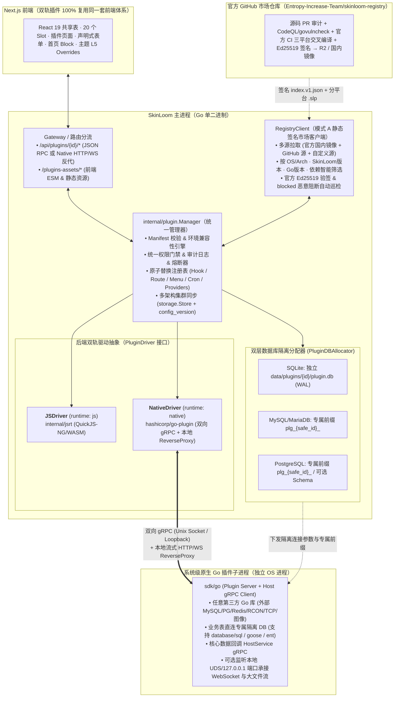

# 10 · 双轨插件架构（JS 沙箱 + Go 原生系统级）与官方插件市场实施方案

> 状态：架构评审定稿（2026-11-19），待执行。  
> 前置基线：P2-1 ~ P2-4（轻量级 TS/JS 沙箱运行时、前端共享模块与 20 插槽、主题 Level ⑤ 覆盖、`.slp` Ed25519 签名与热加载）已完成，见 [ADR 0046](../adr/0046-plugin-host-extensions-and-sdk-toolchain.md)、[ADR 0047](../adr/0047-frontend-plugin-runtime-and-theme-overrides.md)、[ADR 0048](../adr/0048-plugin-package-signing-and-cluster-hot-reload.md)。  
> **执行铁律：严格先完成第一部分「全部基建工作（Phase A → B → C → D）」并通过基建总验收门禁后，再开工第二部分「第一批官方插件与文档冻结（Phase E → F → G）」。**

---

## 一、 架构定位与核心决策总览

为了突破纯 JS/TS 沙箱在**原生网络协议（外部 DB/RCON/TCP/WS）、复杂关系型 SQL 数据表、高吞吐算力与底层基础设施驱动扩展**方面的天花板，同时保留轻量化插件的跨平台零门槛优势，SkinLoom 升级为 **双轨混合插件架构（Dual-Tier Plugin Architecture）**：

| 维度 | Tier 1：轻量级沙箱插件（`runtime: "js"`，已有） | Tier 2：系统级原生插件（`runtime: "native"`，新增） |
| :--- | :--- | :--- |
| **开发语言与 SDK** | TypeScript（`@skinloom/plugin-sdk`） | 后端 **Go**（`sdk/go`）+ 前端可选 TypeScript/React（100% 复用 `@skinloom/plugin-sdk/web`） |
| **执行引擎** | 进程内 QuickJS-NG/WASM 实例池（`internal/jsrt`） | 独立 OS 子进程（`hashicorp/go-plugin` 双向 gRPC + 可选本地 HTTP/WebSocket 流式反代） |
| **隔离与稳定性** | WASM 线性内存硬限（64 MiB）+ 抢占超时中断 | OS 进程级崩溃隔离（插件 panic/OOM 绝不拖垮主站，宿主自动指数退避重启 + 熔断） |
| **核心业务数据** | 通过 `ctx.*` 宿主 API 访问 | **严格通过双向 gRPC `HostService` 访问**（绝不直接写核心表，守住积分/UUID/缓存/审计不变量） |
| **插件自有数据** | `plugin_kv` + `plugin_docs`（预置索引槽位） | **支持完整 SQL 关系库 + 专属前缀 `plg_<safe_id>_`**，覆盖 SQLite / MySQL / PostgreSQL 三种模式 |
| **底层扩展能力** | 32+ Hook、认证/验证码/CDN/Yggdrasil、前端全扩展点 | 除上述全部能力外，新增 `StorageProvider`、`SearchProvider`、`RenderProvider`、`StreamHTTP/WS` |
| **包分发策略** | 单文件跨平台 `.slp`（`<= 20 MiB`） | **按 OS/Arch 分平台 `.slp`**（推荐三平台：`linux`、`windows`、`darwin`；`amd64`/`arm64`；宿主按环境自动筛选拉取；同时兼容离线胖包） |
| **安全与信任策略** | 沙箱隔离 + 三级权限确认；超管可按告警安装社区自签包 | **强供应链信任**：默认强制由官方 GitHub 市场（`skinloom-registry`）**审计源码后由官方 CI 统一交叉编译并加盖 Ed25519 签名**；生产环境默认拒绝未带官方签名的 `native` 插件 |
| **热加载机制** | 原子替换实例池，旧池排空 ≤ 30s | **同样支持热加载**：先拉起新版子进程完成握手与 `OnUpgrade` → 原子切换 gRPC 客户端与路由 → 旧子进程排空在途请求（≤ 30s）后退出 |

---

## 二、 系统架构详细设计

### 2.1 总体分层架构



### 2.2 `plugin.json` 清单扩展设计（完全兼容现有 `apiVersion: 1`）

在现有 [internal/plugin/manifest.go](file:///e:/Dnyo/Documents/work/bs-community/skinloom/internal/plugin/manifest.go) 的 `Manifest` 结构体上进行增量扩展（所有新字段均有默认值，现有 `runtime` 缺省即 `"js"`）：

```jsonc
{
  "$schema": "https://skinloom.cn/schema/plugin.v1.json",
  "id": "bs-importer",
  "kind": "plugin",
  "runtime": "native",                      // 新增："js"（默认）| "native"
  "version": "1.0.0",
  "name": { "zh-CN": "Blessing Skin 迁移助手", "en": "Blessing Skin Importer" },
  "apiVersion": 1,
  "engines": {
    "skinloom": ">=1.0.0 <2.0.0",           // 宿主机 SemVer 约束
    "go": ">=1.26"                          // 新增（native 可选）：编译/运行 Go 基线标注
  },
  "native": {                               // 新增（runtime == "native" 必填）
    "protocolVersion": 1,                   // 双向 gRPC 协议大版本
    "executable": "bin/bs-importer",        // 包内基名：自动匹配 _linux_amd64 / _windows_amd64.exe 等，或单平台直接匹配
    "platforms": [                          // 本包包含的平台列表（分包时长度=1；胖包时长度>=1）
      "linux/amd64"
    ],
    "httpProxy": true,                      // 是否开启本地流式 HTTP/WebSocket 反代数据面
    "database": {                           // 是否申请隔离关系型数据库空间（需配合 "storage.sql" 权限）
      "required": true
    }
  },
  "web": "web/index.js",                    // 前端入口，与 JS 插件完全一致！
  "permissions": [
    "storage.sql",                          // 新增（敏感/高危分级见 §2.4）
    "http.stream",                          // 新增：启用本地 HTTP/WS 流式反代
    "users.read",
    "textures.write"
  ]
}
```

### 2.3 双层数据隔离与三方言专属前缀设计（SQLite / MySQL / PostgreSQL）

为确保核心业务数据零污染，同时赋予原生 Go 插件完整的 SQL 关系建模能力：

1. **核心业务表（严格隔离）**：
   - `users`、`players`、`textures`、`blobs`、`closet_items`、`score_ledger`、`ygg_tokens`、`oauth_*`、`settings`、`audit_logs` 等核心表**绝不开放裸 SQL 写入**，原生插件只能通过双向 gRPC `HostService` 调用宿主领域服务。
2. **插件专属关系库与表前缀规范（三方言统一）**：
   - 专属安全前缀推导规则：将插件 `id`（kebab-case，如 `bs-importer`）中的 `-` 转为 `_`，生成不可伪造的规范前缀 **`plg_<safe_id>_`**（例如 `plg_bs_importer_`），长度上限严格校验，杜绝 SQL 注入。
   - **SQLite 模式**：
     - 宿主为该插件创建独立数据库文件 `<DataDir>/plugins-data/<id>/plugin.db`（开启 `WAL`、`busy_timeout=5000`、`foreign_keys=ON`），下发给插件子进程。
     - **优势**：彻底消除多进程同时写主库 `skinloom.db` 导致的 `SQLITE_BUSY` 锁死；卸载选择 `--purge` 时直接安全清理该目录；`skinloom backup` / `restore` 自动打包 `plugins-data/`，数据零丢失！
     - 插件表名依然使用 SDK 的 `db.Table("tasks")`（产出 `plg_bs_importer_tasks`），保持三方言 SQL 写法 100% 统一。
   - **MySQL / MariaDB 模式**：
     - 在 `config.toml` 支持可选配置 `[plugins.database]`（允许大站运维为原生插件配置单独的 MySQL 数据库或仅授予 `plg_%` 权限的独立账号）；未单独配置时复用站点主库连接，下发 `driver: "mysql"`、`dsn` 与强制前缀 `plg_<safe_id>_`。
     - 卸载选择 `--purge` 时，宿主查询 `information_schema.tables` 中匹配 `table_name LIKE 'plg_<safe_id>_%'` 的表并执行安全 `DROP TABLE`。
   - **PostgreSQL 模式**：
     - 同理支持独立 `[plugins.database]` 配置或复用主库，默认使用 `plg_<safe_id>_` 表前缀（并可选支持独立 Schema `plg_<safe_id>` + `search_path`）。
     - 卸载 `--purge` 时精准清理该前缀/Schema 下属对象，绝不误伤核心表。
3. **Go SDK 封装（`sdk/go/plugindb`）**：
   - 提供 `ctx.DB()` 返回开箱即用的 `*plugindb.DB`（封装 `*sql.DB`、`Dialect() string`、`Prefix() string`、`Table(name string) string` 与三方言迁移运行器 `Migrate(fs.FS)`）。

### 2.4 权限模型扩展与强信任边界

在现有 [internal/plugin/permissions.go](file:///e:/Dnyo/Documents/work/bs-community/skinloom/internal/plugin/permissions.go) 三级权限表上新增系统级权限：

| 权限名 | 风险等级 | 说明 | 仅限 Native |
| :--- | :--- | :--- | :---: |
| `storage.sql` | **敏感（橙色）** | 访问宿主分配的插件专属 SQL 数据库空间（带 `plg_<id>_` 前缀） | ✓ |
| `http.stream` | **敏感（橙色）** | 启用本地 HTTP / WebSocket 流式反向代理通道（突破 1MB/10MB 缓冲限制） | ✓ |
| `provider.storage` | **高危（红色）** | 注册自定义材质对象存储驱动（StorageProvider） | ✓ |
| `provider.search` | **敏感（橙色）** | 注册自定义皮肤库全文搜索引擎驱动（SearchProvider） | ✓ |
| `provider.render` | **敏感（橙色）** | 注册自定义 2D/3D 头像与预览图渲染引擎驱动（RenderProvider） | ✓ |
| `native.exec` | **高危（红色，隐式必带）** | 所有 `runtime: "native"` 插件自动附带该高危标识，明确告知超管该插件将以原生子进程运行 | ✓ |

**`runtime: "native"` 安全强制规则**：
- **生产模式（默认）**：`InstallPackage` 遇到 `runtime == "native"` 时，必须验证 `pkg.Verification.Official == true`（由官方 GitHub 市场私钥签发）或位于超级管理员在 `plugins.trusted_keys` 中明确添加的自托管信任公钥；**默认禁止跳过签名安装未验签的原生二进制**（仅 `web.mode == "dev"` 或 `SKINLOOM_PLUGINS__ALLOW_UNSIGNED_NATIVE=true` 且超管输入插件 ID 二次确认后才允许本地调试）。
- **单包体积限制调整**：`runtime == "js"` 维持 `MaxPackageBytes = 20 MiB`；`runtime == "native"` 允许单平台 `.slp` 归档上限 `50 MiB`（解压上限 `100 MiB`，单二进制文件上限 `64 MiB`），同时支持胖包上限 `150 MiB`。

### 2.5 双向 gRPC 协议与本地流式 HTTP/WS 反代设计

创建 `api/proto/plugin/v1/`（使用标准 Protobuf v3 生成 Go 代码，不引入重量级外部框架）：

1. **控制面（Host → Plugin：`PluginService` gRPC）**：
   - `Init(InitRequest) → InitResponse`：下发 `plugin_id`、`version`、`settings`、`granted_permissions`、`data_dir`、隔离数据库配置（`DatabaseConfig`）、宿主 gRPC 回调 broker ID，返回注册的 Hooks、Routes、Cron、Services、Providers 以及可选本地 HTTP 反代地址（Unix Socket 路径或 `127.0.0.1:port` + 随机 `proxy_secret`）。
   - `Lifecycle(LifecycleRequest) → LifecycleResponse`：`onInstall` / `onEnable` / `onDisable` / `onUpgrade(from)` / `onUninstall(purge)`。
   - `InvokeGuard / InvokeFilter / InvokeEvent`：执行注册的同步/异步 Hook。
   - `InvokeHTTP`：常规轻量 JSON 请求（若插件未启用 `httpProxy`）。
   - `InvokeCron / InvokeService / NotifySettingsChanged`。
   - `HealthCheck`：宿主周期性探活（失败触发退避重启与熔断）。
   - 底层 Provider RPC：`StorageService`（Get/Put/Delete/Stat/URL）、`SearchService`（Index/Delete/Search）、`RenderService`（RenderAvatar/RenderPreview）。
2. **回调面（Plugin → Host：`HostService` gRPC，复用 `go-plugin` `GRPCBroker`）**：
   - 完整映射现有全部 25 个 `ctx.*` 宿主能力（`Users`、`Players`、`Textures`、`Closet`、`Score`、`Notify`、`Mail`、`KV`、`Docs`、`Files`、`Settings`、`Site`、`Audit`、`EmitEvent`、`CallPluginService`、`Log`），**全部经过与 JS 插件完全相同的 `PermissionSet.Check` 权限校验**！
3. **数据面（可选本地 HTTP/WS 流式反代）**：
   - 当插件启用 `httpProxy: true` 时，子进程监听独立 Unix Domain Socket（Linux/macOS 位于 `<DataDir>/run/plugin-<id>-<nonce>.sock`，权限 `0600`；Windows 监听 `127.0.0.1:0`），在 `InitResponse` 返回地址与一次性 256-bit `proxy_token`。
   - SkinLoom 宿主收到 `/api/plugins/<id>/*` 或 `routes.public` 请求后：先在宿主侧完成**会话认证、CSRF 校验、权限级别检查（`public`/`user`/`admin`/`superadmin`）与限流**，再剥离原始 Cookie，注入可信内部头（`X-SkinLoom-Proxy-Token`、`X-SkinLoom-User-ID`、`X-SkinLoom-User-Role`、`X-SkinLoom-Locale`、`X-Request-ID`），通过 `httputil.ReverseProxy` 透明转发给插件（原生支持 WebSocket Upgrade、SSE 与大文件流）。

### 2.6 官方插件市场（模式 A）与多维环境筛选规范

#### 1. `index.v1.json` 扩展规范（支持双轨 + 三平台分包 + 环境依赖筛选）

```json
{
  "schemaVersion": 1,
  "generatedAt": "2026-11-19T12:00:00Z",
  "registryId": "official",
  "mirrors": [
    "https://registry.skinloom.cn",
    "https://raw.githubusercontent.com/Entropy-Increase-Team/skinloom-registry/dist"
  ],
  "packages": [
    {
      "id": "bs-importer",
      "kind": "plugin",
      "runtime": "native",
      "category": "migration",
      "official": true,
      "name": { "zh-CN": "Blessing Skin 迁移助手", "en": "Blessing Skin Importer" },
      "description": { "zh-CN": "直连数据库或桥接导入 BS 扩展插件数据", "en": "Import BS plugin extension tables via direct DB or bridge" },
      "authors": ["Entropy-Increase-Team"],
      "license": "MIT",
      "repository": "https://github.com/Entropy-Increase-Team/skinloom",
      "latest": "1.0.0",
      "versions": [
        {
          "version": "1.0.0",
          "apiVersion": 1,
          "nativeProtocolVersion": 1,
          "engines": { "skinloom": ">=1.0.0 <2.0.0", "go": ">=1.26" },
          "permissions": ["storage.sql", "http.stream", "users.read", "textures.write"],
          "dependencies": {},
          "optionalDependencies": { "invitation-codes": "^1.0.0", "mojang-verification": "^1.0.0" },
          "publishedAt": "2026-11-19T12:00:00Z",
          "yanked": false,
          "artifacts": {
            "linux/amd64":   { "urls": ["..."], "sha256": "...", "size": 4520100, "signature": "..." },
            "linux/arm64":   { "urls": ["..."], "sha256": "...", "size": 4310200, "signature": "..." },
            "windows/amd64": { "urls": ["..."], "sha256": "...", "size": 4680900, "signature": "..." },
            "darwin/arm64":  { "urls": ["..."], "sha256": "...", "size": 4410500, "signature": "..." },
            "darwin/amd64":  { "urls": ["..."], "sha256": "...", "size": 4550300, "signature": "..." }
          }
        }
      ]
    }
  ],
  "blocked": []
}
```
> 注：对于 `runtime: "js"` 与纯静态主题，`artifacts` 仅需一个 `"any"` 键即可全平台通用；对于 `runtime: "native"`，推荐开发者配置官方提供的 GitHub Action 矩阵，自动构建并产出三平台（Linux `amd64`/`arm64`、Windows `amd64`、macOS `arm64`/`amd64`）分包。

#### 2. 多维环境与依赖兼容性筛选引擎（`internal/plugin/compat.go`）
宿主拉取 `index.v1.json` 后，自动基于本机运行环境进行五维校验并计算每个插件的推荐可安装版本：
1. **平台匹配**：`runtime == "js"` 匹配 `"any"`；`runtime == "native"` 精确匹配 `runtime.GOOS + "/" + runtime.GOARCH`（若该版本无本机平台构建产物，标记 `incompatible_platform` 并在市场默认折叠/灰显）。
2. **SkinLoom 版本匹配**：解析 SemVer 范围（`engines.skinloom`）对比 `buildinfo.Version`。
3. **API 与协议版本匹配**：校验 `apiVersion == 1` 且 `nativeProtocolVersion == 1`。
4. **Go 基线版本检查**：展示/校验 `engines.go` 与当前宿主编译的 Go 版本（`runtime.Version()`）。
5. **依赖树解析**：检查 `dependencies` 是否已安装或在当前市场可一键级联安装，检测版本冲突与循环依赖。

#### 3. 官方市场供应链安全流程（`skinloom-registry`）
1. **提交**：开发者向 `skinloom-registry` 提 PR，提交 `manifests/<id>.yaml`（含开源 Git 仓库 URL、Tag/Commit SHA、权限说明、构建入口）。
2. **分级审核**：
   - `runtime: "js"` 且非首次上架、未新增敏感/高危权限 → CI 自动验证构建、跑 `skinloom-plugin lint` & 恶意规则扫描，全绿自动合并。
   - 首次上架、新增敏感/高危权限、或**所有 `runtime: "native"` 原生插件** → 强制人工源码 Review + CodeQL + `govulncheck` 扫描。
3. **官方受控编译与签名**：PR 合并后，官方 GitHub Actions Runner 拉取固定 Commit SHA，使用 `CGO_ENABLED=0` 交叉编译三平台分包（`linux/amd64`, `linux/arm64`, `windows/amd64`, `darwin/arm64`, `darwin/amd64`），使用存放在受保护 GitHub Environment Secrets 中的**官方 Ed25519 私钥**对每个 `.slp` 包及总索引 `index.v1.json` 签名，并自动同步至 Cloudflare R2 主源与国内 CDN 镜像。

---

## 三、 完整开发任务清单（Checklist，便于检查与调整）

> **执行顺序声明**：必须严格按 **第一部分（基建：Phase A → B → C → D）** 全部完成后，再进入 **第二部分（官方插件与收官：Phase E → F → G）**。

---

### 第一部分：核心基建工作（Infrastructure First —— 必先全部完成）

#### 阶段 A（P2-5A）：双轨驱动抽象、双向 gRPC 协议、原生进程引擎与隔离 DB 基建

- [x] **A1. 扩展数据库 Schema 与三方言迁移**
  - 修改 [ent/schema/plugin.go](file:///e:/Dnyo/Documents/work/bs-community/skinloom/ent/schema/plugin.go)：新增字段 `runtime` (`enum: "js", "native"`, default `"js"`)、`platform_packages` (`JSON: map[string]string`，记录多架构集群下 `linux/amd64 -> sha256` 映射)、`registry_source` (`string`, 记录安装来源市场 URL 以便多架构节点回源拉取)。
  - 运行 `go generate ./ent`，补齐 `migrations/{sqlite,mysql,postgres}/` 三方言增量迁移并跑通 `go run ./internal/tools/migdiff`。
- [x] **A2. 扩展 `Manifest`、权限表与兼容性校验引擎**
  - 修改 [internal/plugin/manifest.go](file:///e:/Dnyo/Documents/work/bs-community/skinloom/internal/plugin/manifest.go)：新增 `Runtime`、`Engines.Go`、`NativeSpec` 字段及严格校验。
  - 修改 [internal/plugin/permissions.go](file:///e:/Dnyo/Documents/work/bs-community/skinloom/internal/plugin/permissions.go)：新增 `storage.sql`、`http.stream`、`provider.storage`、`provider.search`、`provider.render`、`native.exec` 权限定义与分级。
  - 新增 `internal/plugin/compat.go` + `compat_test.go`：实现 SemVer 范围解析器与 5 维环境兼容性筛选（OS/Arch、SkinLoom 版本、API 版本、Native 协议版本、Go 版本、依赖检查）。
- [x] **A3. 定义并生成双向 gRPC 协议（`api/proto/plugin/v1/`）**
  - 编写 `plugin.proto`（`PluginService`、`HostService`、`StorageProviderService`、`SearchProviderService`、`RenderProviderService`）。
  - 生成 Go gRPC 桩代码并纳入 `go generate` 校验（通过纯 Go `internal/tools/protogen`）。
- [x] **A4. 重构 `internal/plugin` 后端执行层为统一 `PluginDriver` 接口**
  - 将现有 [internal/plugin/runtime.go](file:///e:/Dnyo/Documents/work/bs-community/skinloom/internal/plugin/runtime.go) 中与 `jsrt` 耦合的调用抽离为 `internal/plugin/driver.go`（`Driver` 接口：`Init`, `Lifecycle`, `InvokeGuard`, `InvokeFilter`, `InvokeEvent`, `InvokeHTTP`, `InvokeCron`, `InvokeService`, `NotifySettings`, `ProxyHandler`, `Stats`, `DrainAndClose`）与 `internal/plugin/driver_jsrt.go`（因 Go 工具链将 `*_js.go` 固定视为 `GOOS=js` 构建约束，故命名为 `driver_jsrt.go`；保留现有全部 JS/TS 测试 100% 绿色）。
- [x] **A5. 实现 `internal/plugin/driver_native.go`（`hashicorp/go-plugin` 原生进程引擎）**
  - 引入 `github.com/hashicorp/go-plugin` 与 `google.golang.org/grpc`。
  - 实现子进程生命周期管理：自动识别平台二进制并设置 Unix `0755` 可执行权限；启动握手、stdout/stderr 归集至插件 `slog` 日志缓冲；`GRPCBroker` 反向注册 `HostService`（复用现有 `host_*.go` 业务能力与权限检查）。
  - 实现异常崩溃监管（指数退避自动重启 + 接入 `CircuitBreaker` 连续崩溃熔断）与热升级平滑排空（先启新版握手 → 原子切换 → 旧进程排空 ≤ 30s 后 `Kill`）。
  - 实现本地流式 HTTP/WebSocket 反代数据面（Unix Socket / `127.0.0.1` + 一次性 `X-SkinLoom-Proxy-Token` 鉴权头 + 剥离原始 Cookie 注入可信用户头）。
- [x] **A6. 实现双层隔离数据库分配器（`internal/plugin/db_allocator.go`）**
  - 实现 `SafeSQLPrefix(pluginID)`（严格正则生成 `plg_<safe_id>_`）。
  - 支持三种数据库模式：
    - SQLite：自动初始化 `<DataDir>/plugins-data/<id>/plugin.db`（WAL 模式），并在 `internal/backup/` 备份恢复流程中自动包含 `plugins-data/`；
    - MySQL / MariaDB：支持 `[plugins.database]` 独立配置或复用主库 + 专属前缀 `plg_<safe_id>_`；
    - PostgreSQL：支持 `[plugins.database]` 独立配置或复用主库 + 专属前缀 `plg_<safe_id>_`（可选 Schema）。
  - 实现卸载 `--purge` 时三方言精准清理本插件专属表/独立库文件（附带三方言集成测试）。
- [x] **A7. 接入原生底层基础设施扩展点**
  - 在 `internal/platform/storage` / `internal/modules/texture` / `internal/modules/render` 中预留可原子热替换的 `StorageProvider`、`SearchProvider`、`RenderProvider` 钩子，供拥有对应高危/敏感权限的 `native` 插件注册与卸任回收。

---

#### 阶段 B（P2-5B）：Go 插件 SDK、多平台打包签名工具链与管理后台升级

- [x] **B1. 实现官方 Go 插件 SDK（`sdk/go`）**
  - 独立模块或子包 `sdk/go`（对外导入路径 `github.com/Entropy-Increase-Team/skinloom/sdk/go`）：
    - `plugin.Serve(p Plugin)` 一行启动 `go-plugin` gRPC 服务端 + 可选本地 HTTP/WS 服务；
    - 强类型 `Context`（映射全部 Hook、`Users`/`Players`/`Textures`/`Score`/`Notify`/`Mail`/`KV`/`Docs`/`Files`/`Settings`/`Services` gRPC 客户端）；
    - `sdk/go/plugindb`：封装三方言隔离 SQL 连接池、`Table(name)` 自动加前缀、内置 `goose` 迁移辅助；
    - `sdk/go/plugintest`：提供内存模拟宿主（Mock `HostService` + 内存 SQLite），支持标准 `go test` 直接单测原生插件。
- [x] **B2. 升级 `.slp` 解包器、签名策略与多架构集群同步**
  - 修改 [internal/plugin/package.go](file:///e:/Dnyo/Documents/work/bs-community/skinloom/internal/plugin/package.go)：
    - 放宽 `runtime == "native"` 归档大小上限（单平台 50 MiB / 胖包 150 MiB），校验二进制路径安全与当前 `GOOS/GOARCH` 可执行文件存在性；
    - 强化原生二进制安全策略：生产环境未带官方签名（或超管自定义受信任公钥）的 `native` 包默认硬拒绝，返回明确错误码与提示；
    - 更新 [internal/modules/texture/upkeep.go](file:///e:/Dnyo/Documents/work/bs-community/skinloom/internal/modules/texture/upkeep.go) 孤儿清扫逻辑，兼容保护 `plugins.platform_packages` 中所有架构的 SHA-256 归档对象。
  - 修改 [internal/plugin/packages_mgr.go](file:///e:/Dnyo/Documents/work/bs-community/skinloom/internal/plugin/packages_mgr.go)：`SyncCluster` 按本机 `GOOS/GOARCH` 选取对应架构的包（本地对象存储缺失本架构包且来源为市场时，自动按 `registry_source` 拉取本机平台包并验签）。
- [x] **B3. 升级 CLI、脚手架与单源生成器**
  - 更新 `internal/tools/plugingen`：同步生成包含 `runtime`、`native`、`engines.go`、新权限的 `plugin.v1.json` 与 TS 类型，通过 `plugingen -check`。
  - 扩展 `web/packages/cli`（`skinloom-plugin`）：
    - 支持 `skinloom-plugin build --native --targets linux/amd64,linux/arm64,windows/amd64,darwin/arm64,darwin/amd64`（自动调用 `go build` `CGO_ENABLED=0` 交叉编译，并同时打包前端 `web/index.js`）；
    - 支持 `skinloom-plugin pack --split-platforms`（按推荐策略输出三平台分包 `.slp` + `artifacts.json` 清单，也支持 `--fat` 离线胖包）；
    - 支持 `skinloom-plugin dev` 监听 `.go` 与 `.tsx` 变更，自动重编子进程并通过 `dev-reload` 热替换。
  - 扩展 `web/packages/create-plugin`：新增 `native-go`（Go 后端 + React 前端 + 隔离 SQL 迁移）模板。
- [x] **B4. 升级管理后台「插件管理」UI**
  - 修改 `web/apps/web/src/components/admin/plugins-*.tsx` 与 API 契约：
    - 列表与安装预检框清晰展示双轨标识：**「轻量沙箱 (JS)」** vs **「系统原生 (Go)」**，标注适用平台与官方源码编译认证徽章；
    - 详情抽屉针对 `native` 插件展示：子进程 PID、存活时间、重启次数、内存/RSS 占用、隔离数据库模式与表前缀、本地反代状态；
    - 高危确认框：针对 `native` 插件明确提示「原生子进程权限」，未带官方签名时在生产模式禁用安装按钮并给出原因说明。

---

#### 阶段 C（P2-5C）：官方 GitOps 静态签名插件市场（模式 A）完整落地

- [x] **C1. 实现宿主多源 Registry 客户端（`internal/plugin/registry_client.go`）**
  - 新增站点设置 `plugin.registries`（支持多个源：官方主源/国内镜像默认预置，支持超管增删自定义源、配置自定义源公钥与启用开关）。
  - 实现 `FetchIndex(ctx)`：
    - 并行/故障转移拉取 `index.v1.json` 与 `index.v1.json.sig`（优先国内镜像，超时/失败自动切换 GitHub 源）；
    - 对官方源强制使用内置 `OfficialPublicKeyPEM` 验签，防中间人篡改索引或伪造阻断名单；
    - 内存 + 本地文件短缓存（默认 15 分钟），支持管理员手动强制刷新。
  - 集成 `compat.go` 环境筛选：返回每个市场插件的 `compatibility` 状态、适配当前 `GOOS/GOARCH` 的推荐下载 artifact、本地是否已安装及是否有可升级版本。
  - 实现 `blocked` 恶意阻断定时巡检任务（每 6 小时 + 刷新市场时触发）：命中官方签名索引 `blocked` 名单的已启用插件，立即热禁用、写审计日志并向所有超级管理员发站内通知。
  - 实现一键从市场下载安装/升级（`InstallFromMarket`）：按 artifact 的 `urls` 故障转移下载对应本机平台的 `.slp` → 校验 `sha256` 与 `signature` → 复用 `InspectPackage` / `InstallPackage` 走完整三级权限确认与热加载流程。
- [x] **C2. 新增市场管理 REST API 与 CLI**
  - `GET /api/v1/admin/market/packages`（支持按 `q`、`kind`、`runtime`、`category`、`compatibleOnly` 筛选，返回宿主环境摘要 `hostEnv` 与筛选后包列表）。
  - `POST /api/v1/admin/market/refresh`（强制刷新市场索引并执行阻断检查）。
  - `POST /api/v1/admin/market/inspect`（按 `{ registryId, id, version }` 拉取本机平台包并返回预检与权限 diff）。
  - `POST /api/v1/admin/market/install`（超管确认权限后完成一键安装/升级，支持自动级联提示依赖插件）。
  - CLI 扩展：`skinloom plugin search <query>`、`skinloom plugin market-install <id>[@version]`、`skinloom plugin upgrade <id|--all>`。
- [x] **C3. 实现后台「插件与主题市场」UI**
  - 在 `/admin/plugins` 增加「插件市场」Tab，并在 `/admin/appearance` 主题页增加「浏览主题市场」入口。
  - 页面功能：
    - 顶部展示当前服务器环境胶囊（如 `linux/arm64 · SkinLoom 1.x · Go 1.26`）与「仅显示兼容插件」默认勾选开关；
    - 分类筛选（全部 / 官方推荐 / 轻量沙箱 / 系统原生 / 主题 / 登录安全 / 运营积分 / 迁移工具）+ 关键字搜索；
    - 卡片展示双轨标签（JS 沙箱 / Go 原生）、官方认证徽章、支持平台图标（Linux / Windows / macOS）、兼容状态提示、一键安装/升级按钮（复用权限确认弹窗）与版本更新日志抽屉。
- [x] **C4. 产出官方市场独立仓库（`Entropy-Increase-Team/skinloom-registry`）**
  - 已独立初始化并推送至 `Entropy-Increase-Team/skinloom-registry`（主仓库不再保留冗余副本）：
    - `manifests/` 示例结构与 JSON Schema 校验脚本；
    - `.github/workflows/pr-check.yml`（PR 阶段：校验清单、对 JS 插件跑 `lint`/打包测试、对 Native Go 插件跑 `go vet`/`govulncheck`/CodeQL 并强制打上 `needs-security-review` 标签）；
    - `.github/workflows/publish.yml`（合并后：按固定 Commit SHA 在隔离 Runner 中**自动交叉编译三平台分包** → 生成 `checksums.txt` → 官方 Ed25519 私钥签名 → 生成并签名 `index.v1.json` → 同步 R2 主源与国内镜像）。

---

#### 阶段 D（基建总验收门禁 —— 全部通过后方可开工官方插件！）

- [x] **D1. 代码质量、静态分析与安全扫描**
  ```bash
  gofmt -l $(git ls-files '*.go')
  go vet ./...
  go run honnef.co/go/tools/cmd/staticcheck@latest ./...
  go run golang.org/x/vuln/cmd/govulncheck@latest ./...
  ```
- [x] **D2. 三方言迁移与双层数据隔离回归**
  ```bash
  go run ./internal/tools/migdiff
  go test -race ./internal/hook/... ./internal/jsrt/... ./internal/plugin/... ./internal/httpapi/... ./sdk/go/...
  ```
- [x] **D3. 单源契约无漂移校验**
  ```bash
  go generate ./api && git diff --exit-code -- api/
  go run ./internal/tools/plugingen -check
  cd web && bun run gen:api && git diff --exit-code -- packages/api-client/src/gen
  ```
- [x] **D4. 前端与工具链构建测试**
  ```bash
  cd web && bun run check:styles && bun run typecheck && bun run test && bun run build
  ```
- [x] **D5. 基建端到端冒烟场景（必须全部实测通过）**
  1. 搭建本地静态测试 Registry，同时托管 1 个最小 JS 插件、1 个最小 Native Go 插件（含三平台分包 + 隔离 SQL 建表 + 本地 HTTP/WS 反代）、1 个 Level ⑤ 主题；
  2. 验证宿主自动按 `GOOS/GOARCH` 过滤并拉取正确平台包、拒绝未签名的 `native` 包、确认权限后不重启热安装并生效；
  3. 模拟杀死 `native` 插件子进程，验证主站无感存活且子进程自动拉起恢复服务；
  4. 模拟 `index.v1.json` 加入 `blocked` 阻断条目，验证宿主巡检后自动禁用并通知超管；
  5. 补写架构决策记录：**ADR 0049（双轨插件架构、双向 gRPC 与隔离关系数据库）** 与 **ADR 0050（GitOps 静态签名插件市场与三平台官方编译分发）**。

---

### 第二部分：第一批官方插件落地与 API 1.0 冻结（基建验收后开工）

> **第二部分架构定稿约束（2026-11-19 确认）**：
> 1. **官方插件独立单仓（`Entropy-Increase-Team/skinloom-plugins`）**：所有官方插件与官方市场主题均统一维护在独立仓库 `Entropy-Increase-Team/skinloom-plugins`（本地并行目录 `../skinloom-plugins`），**不再放入 `skinloom` 主仓库**；主仓库只保留核心服务、前端、内置默认/织锦主题以及官方 SDK/CLI 工具链（`sdk/go`、`@skinloom/plugin-sdk`、`@skinloom/cli`、`create-skinloom-plugin`）。三仓职责彻底解耦：`skinloom`（宿主与 SDK）· `skinloom-plugins`（官方插件与主题源码）· `skinloom-registry`（GitOps 静态签名索引与受控编译分发）。
> 2. **Blessing Skin 迁移采用方案 A（两层职责分离）**：
>    - **核心数据迁移保留在主程序系统代码（`internal/importer/bs/`）**：继续承接 Pre-Core 首次安装向导（`/setup`）与离线 CLI（`skinloom import bs` / `compare`），保障原始主键 ID 保留、旧算法密码哈希迁移、Yggdrasil RSA 私钥导入与整库原子 `--dry-run`，且进入正常 Core 模式后**零路由、零任务、零内存开销**，绝不向插件 `HostService` 开放高危核心表后门。
>    - **BS 第三方插件生态数据迁移做成可卸载 Tier 2 原生插件（`skinloom-plugins/bs-importer`）**：站长完成核心迁移并按需从市场安装 `invitation-codes`、`mojang-verification` 等官方插件后，再安装 `bs-importer` 补导旧 BS 第三方插件表数据；迁移完成后可直接在后台禁用或 `remove --purge` 彻底卸载，不残留任何后台菜单与隔离表。

#### 阶段 E（P2-6A）：初始化 `skinloom-plugins` 独立仓库、轻量级 TS 沙箱官方插件与 Level ⑤ 示例主题

- [x] **E0. 初始化官方插件仓库（`Entropy-Increase-Team/skinloom-plugins`）**
  - 已在独立并行目录 `../skinloom-plugins` 建立多插件工作区（根目录 `README.md` / `README.en.md`、`LICENSE`、`package.json`、`tsconfig.base.json`、`vitest.config.mjs`、`scripts/run-all.mjs` 及 `.github/workflows/ci.yml`），零冗余依赖复用主仓库工具链与 Go SDK。
- [x] **E1. 官方插件 ①：`skinloom-plugins/invitation-codes`（Tier 1 · TS 沙箱）**
  - 清单声明 `forms["auth.register"]` 附加 `invite_code` 字段；`storage.collections.codes`（`code: string:unique`, `status: string`, `creatorId: number`, `usedBy: number`, `createdAt: time`, `expiresAt: time`）。
  - 后端：`auth.register` Guard 校验邀请码有效性；`user.registered` Event 消费计数并触发邀请人与新用户积分奖励；支持管理员批量生成/撤销/删除/防公式注入 CSV 导出、玩家积分兑换邀请码；暴露 `importCodes` 服务；附完整 `createTestHost` 单测并实测 `lint` / `typecheck` / `test` / `pack`（`9.1 KB` `.slp`）通过。
- [x] **E2. 官方插件 ②：`skinloom-plugins/mojang-verification` & `skinloom-plugins/texture-description`（Tier 1 · TS 沙箱）**
  - `mojang-verification`：实现 Microsoft OAuth → XBL → XSTS → Minecraft Services 正版档案校验、同名角色冲突回收退分 + 站内信/邮件通知、改名同步、`user.badges` Filter 颁发「正版认证」徽章、`user.dashboard.widgets` / `user.profile.sections` 插槽卡片与 `importVerifications` 服务，附完整 `fetchMock` 端到端单测并打包验证（`7.2 KB` `.slp`）。
  - `texture-description`（同步补齐第 3 张 BS 扩展表闭环）：声明 `forms["texture.upload"]`、`texture.upload` Guard / `texture.uploaded` / `texture.deleted` Event、`skinlib.detail.below` 插槽展示与作者/管理员在线编辑、私有权限隔离与 `importDescriptions` 服务，附单测并打包验证（`4.5 KB` `.slp`）。
- [x] **E3. 官方 Level ⑤ 示例主题：`skinloom-plugins/theme-atelier`（`kind: "theme"`）**
  - 展示 L1 亮暗 `oklch` Token + L2 分栏/标签布局与首页 + L3 `theme.settings` + L4 无 Layer `theme.css` + L5 `overrides`（覆盖 `site.footer` 与 `texture.card`），`lint` / `typecheck` / `test` / `pack`（`4.1 KB` `.slp`）全部通过。

#### 阶段 F（P2-6B）：系统级原生 Go 官方插件 `skinloom-plugins/bs-importer` 与官方市场闭环实战

- [x] **F1. 官方插件 ③：`skinloom-plugins/bs-importer`（Tier 2 · 原生 Go 系统级插件，按需安装、迁完即卸）**
  - 遵循方案 A：仅承接核心迁移完成后的 **BS 第三方插件生态数据补迁**（`invitation_codes`、`mojang_verifications`、`textures_description`），支持 Go 原生直连 MySQL / PostgreSQL / SQLite（严格正则表前缀防注入）以及 HTTP 对接 `blessing-skin-export-bridge`（已同步升级 `blessing-skin-export-bridge/src/Controllers/BridgeController.php` 开放三张扩展表分页读取）。
  - 使用 `sdk/go/plugindb` 隔离 SQL 库（三方言迁移 `migrations/{sqlite,mysql,postgres}/001_init.sql`）持久化任务历史与报告，通过 `ctx.HTTP.StreamFunc` 提供实时 SSE 进度流，经由跨插件 `ctx.Services.Call` 幂等写入三大目标插件。
  - 前端 UI（`admin:/bs-importer`）展示方案 A 卸载指引、数据源切换测试、Dry-Run 预览、分表勾选、SSE 实时日志与历史任务表；通过 `plugintest` 双模式（SQLite 直连 + HTTP Bridge + SSE）单测，并实测 `skinloom-plugin pack --native --split-platforms` 交叉编译生成 `linux/amd64`、`windows/amd64`、`darwin/arm64` 分包（约 8.2–8.7 MiB）与 `artifacts.json`。
  - 已同步更新主仓库 [internal/importer/bs/plugins.go](file:///e:/Dnyo/Documents/work/bs-community/skinloom/internal/importer/bs/plugins.go) 与 [internal/importer/bs/tables.go](file:///e:/Dnyo/Documents/work/bs-community/skinloom/internal/importer/bs/tables.go) 迁移报告提示文案并通过全部 `internal/importer/bs` 回归测试。
- [ ] **F2. 官方市场 GitOps 实战上架与云端 Runner 闭环验证（待远端建仓与配置签名私钥）**
  - 将本地 `../skinloom-plugins` 推送至 GitHub `Entropy-Increase-Team/skinloom-plugins` 并打首发 Tag；
  - 在 `Entropy-Increase-Team/skinloom-registry` 配置 `production-signing` Environment 与正式 `SKINLOOM_REGISTRY_PRIVATE_KEY` Secret；
  - 提交 5 个官方包的 PR 触发 `pr-check.yml` → 合并触发 `publish.yml` 实测云端 5 平台编译签名与本地 SkinLoom 市场一键安装。

#### 阶段 G（P2-6C）：文档站定稿与插件 API v1 冻结

- [x] **G1. 文档站「插件与主题开发」栏目补齐（`website/docs/plugins/`）**
  - 新增 [quickstart-ts.md](file:///e:/Dnyo/Documents/work/bs-community/skinloom/website/docs/plugins/quickstart-ts.md)（15 分钟写一个 TS 轻量级插件）；
  - 新增 [native-go.md](file:///e:/Dnyo/Documents/work/bs-community/skinloom/website/docs/plugins/native-go.md)（开发 Go 系统级原生插件：`sdk/go`、双向 gRPC、隔离 SQL、流式 SSE、五平台打包）；
  - 新增 [reference.md](file:///e:/Dnyo/Documents/work/bs-community/skinloom/website/docs/plugins/reference.md)（API v1.0 参考手册：29 项权限分级、47 个 Hook、20 个插槽、5 处表单、7 个主题覆盖目标与 `.slp` 市场规范）；
  - 完善 [overview.md](file:///e:/Dnyo/Documents/work/bs-community/skinloom/website/docs/plugins/overview.md)、[themes.md](file:///e:/Dnyo/Documents/work/bs-community/skinloom/website/docs/plugins/themes.md) 与 [website/sidebars.ts](file:///e:/Dnyo/Documents/work/bs-community/skinloom/website/sidebars.ts)。
- [x] **G2. CI 验收与 API v1.0 冻结**
  - `cd website && bun run build` 零死链构建通过；
  - 更新 [CHANGELOG.md](file:///e:/Dnyo/Documents/work/bs-community/skinloom/CHANGELOG.md) 并发布里程碑开发日志 [2026-11-19-dual-tier-plugins-and-market.md](file:///e:/Dnyo/Documents/work/bs-community/skinloom/website/devlog/2026-11-19-dual-tier-plugins-and-market.md)；
  - 正式冻结 `apiVersion: 1` 与 `native.protocolVersion: 1`。
